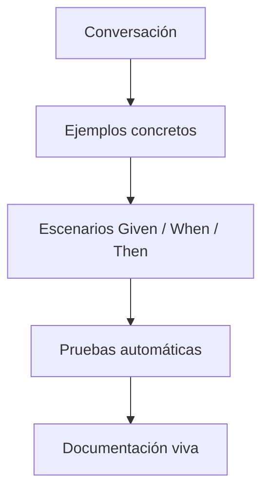

# Behaviour-Driven Development (BDD)

**En una frase:** Acordar el comportamiento esperado con ejemplos concretos, en el lenguaje del negocio, antes de construirlo, y convertir esos ejemplos en pruebas que corren solas.

**Área:** Ingeniería · **Lectura:** ~3 min

## Qué es

Dan North lo presentó en "Introducing BDD" (2006). Nació enseñando TDD: la palabra *test* hacía pensar en verificar al final, no en diseñar. North propuso hablar de **comportamiento**, nombrar cada prueba como una oración que empieza con *should* ("debería") y llevar la misma idea a los criterios de aceptación de las historias con una plantilla: **Given** (contexto), **When** (evento), **Then** (resultado esperado).

Tomó de *Domain-Driven Design* la idea de un **lenguaje ubicuo**: negocio, QA y desarrollo usan las mismas palabras, y esas palabras quedan en las pruebas.

Lo central es la conversación. La herramienta (Cucumber, Behave u otra) es lo último y lo menos importante.

## Para qué sirve (y cuándo no)

Sirve cuando los defectos más caros son malentendidos: "funciona, pero no es lo que pedí". Los ejemplos destapan reglas de negocio y casos borde antes de escribir código, cuando cambiar de idea es barato. Los escenarios automatizados quedan como documentación que avisa cuando deja de ser cierta.

No conviene escribir escenarios para todo. La lógica interna se cubre mejor con pruebas unitarias; la exploración de una interfaz nueva, con pruebas exploratorias; un spike, con nada. Y escenarios que manejan la interfaz gráfica paso a paso suelen ser lentos, frágiles y caros de mantener.

## Cómo se aplica

1. **Conversación de tres miradas** (*three amigos*: negocio, desarrollo y QA) sobre cada historia, dentro del refinamiento. Como referencia, 15 a 30 minutos por historia mediana.
2. **Pide ejemplos, no requisitos:** "¿Qué pasa si el archivo pesa 6 MB?", "Dame un caso en que esto falle".
3. **Escribe escenarios declarativos:** qué ocurre en el negocio, no en qué botón se hace clic. Un comportamiento por escenario.
4. **Conéctalo con los acuerdos del equipo:** los criterios en Given / When / Then son parte de la DoR, y verificarlos (automatizados cuando se puede) es parte de la DoD. La plantilla y un ejemplo están en [DoR y DoD](../../caja-de-herramientas/dor-dod.md).
5. **Automatiza los críticos** a nivel de servicio o API y córrelos en el pipeline.
6. **Cuida la suite:** un escenario que falla es una conversación, no un ticket para QA.

## Errores típicos

- Comprar la herramienta y saltarse la conversación.
- QA escribe los escenarios solo, después de que el código existe.
- Escenarios imperativos ("hago clic en Continuar") que se rompen con cada cambio visual.
- Usar Given / When / Then como relleno de la descripción de la historia, sin ejemplos reales.
- Cientos de escenarios end-to-end que tardan una hora y fallan al azar.

## Qué observar al llegar a un equipo

- ¿Quién escribe los criterios de aceptación, y cuándo: antes o después del desarrollo?
- ¿Los criterios tienen ejemplos concretos o dicen "debe funcionar correctamente"?
- En el refinamiento, ¿se discuten casos borde o solo se estima?
- ¿Cuántos bugs del último mes fueron "no era lo que pedí"?
- ¿Los escenarios automatizados corren en el pipeline? ¿Cuánto tardan?
- ¿Una persona de negocio puede leerlos y decir si son correctos?

## Relacionado

- [Extreme Programming](xp.md) · [Trunk-based development](trunk-based.md)
- [Refinamiento del Product Backlog](../scrum/refinamiento.md) · [Artefactos y compromisos](../scrum/artefactos-y-compromisos.md)
- [DoR y DoD](../../caja-de-herramientas/dor-dod.md) · [Fase 2 §2.5 Estrategia de QA](../../fases/02-fundaciones-tecnicas.md#25-estrategia-de-qa) · [Fase 4 · Entrega continua](../../fases/04-entrega-continua.md)

## Para profundizar

- Dan North, "Introducing BDD", *Better Software*, marzo de 2006. Versión web en [dannorth.net](https://dannorth.net/blog/introducing-bdd/).
