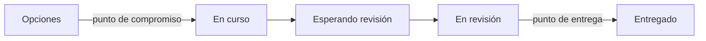

# Visualizar: diseño del tablero y puntos de compromiso y entrega

**En una frase:** Visualizar es mostrar el flujo real del trabajo, con sus esperas, bloqueos y tipos, y marcar dónde el equipo se compromete con un ítem y dónde lo entrega.

**Área:** Kanban · **Lectura:** ~3 min

## Qué es

Un tablero Kanban es un modelo del proceso, no una lista de tareas. Muestra los estados por los que pasa un ítem de valor, desde que alguien lo pide hasta que llega al cliente.

Dos marcas ordenan el tablero:

- **Punto de compromiso:** la línea a partir de la cual el equipo se compromete a terminar el ítem. Antes de ella hay **opciones**, que se pueden descartar sin costo.
- **Punto de entrega:** donde el ítem llega al cliente o queda disponible para usarse.

En el Kanban Method, el **lead time** se mide entre ambos puntos. La Kanban Guide pide algo equivalente: que la Definition of Workflow diga cuándo un ítem se considera iniciado y terminado.

## Para qué sirve (y cuándo no)

Hace visible lo que una lista esconde: dónde espera el trabajo, qué está bloqueado y cuánto se empezó sin terminar. También separa la conversación de qué opciones vale la pena tomar de la de cómo terminar lo ya comprometido.

No arregla nada por sí solo. Un tablero perfecto con el equipo sobrecargado sigue mostrando un equipo sobrecargado. Si el trabajo es de un solo paso y muy repetitivo, una lista simple con su WIP controlado puede bastar.

## Cómo se aplica

1. Sigue tres o cuatro ítems reales de punta a punta y anota cada estado y cada espera. El [Value Stream Mapping](../../caja-de-herramientas/value-stream-map.md) sirve para esto.
2. Crea columnas para los estados reales y separa **en curso** de **listo** para que las esperas se vean.
3. Marca en el tablero el punto de compromiso y el de entrega.
4. Distingue los tipos de trabajo con color o carril, incluido el soporte y lo que llega por chat.
5. Haz visibles los bloqueos con motivo y fecha.
6. Revisa el diseño cada cierto tiempo: el tablero cambia con el proceso.

La [Fase 3 §3.3](../../fases/03-sistema-de-trabajo.md#33-disenar-el-tablero) trae un ejemplo de columnas.

## Errores típicos

- Columnas por persona o por herramienta, en vez de por estado del trabajo.
- Tarjetas que son tareas sueltas y no ítems de valor.
- El tablero termina en "Hecho por desarrollo", lejos del cliente.
- Trabajo invisible: soporte, pedidos de pasillo, reuniones de preventa.
- Un punto de compromiso difuso: todo lo que entra al backlog parece comprometido.

## Qué observar al llegar a un equipo

- ¿Dónde termina el tablero? ¿En producción, en manos del usuario o antes?
- ¿Hay columnas de espera? ¿Cuántos ítems hay en ellas comparadas con las activas?
- ¿El equipo sabe señalar su punto de compromiso? ¿Quién decide que un ítem lo cruza?
- ¿Los bloqueos están marcados y tienen fecha?
- Pregunta a qué dedicaron la semana. ¿Qué parte de eso no aparece en el tablero?
- ¿El tablero se actualiza durante el día o solo antes de la daily?

## Relacionado

- [Kanban en una página](kanban-en-una-pagina.md) · [WIP y sistema pull](wip-y-pull.md) · [Políticas explícitas](politicas-explicitas.md)
- [Value Stream Mapping](../../caja-de-herramientas/value-stream-map.md)
- [Políticas del tablero](../../caja-de-herramientas/politicas-tablero.md)

## Para profundizar

- David J. Anderson y Andy Carmichael, *Essential Kanban Condensed*, Lean Kanban University Press, 2016.
- Daniel Vacanti y John Coleman (con otros colaboradores), *The Kanban Guide*, mayo de 2025, sección sobre la Definition of Workflow. [kanbanguides.org](https://kanbanguides.org/english/).
