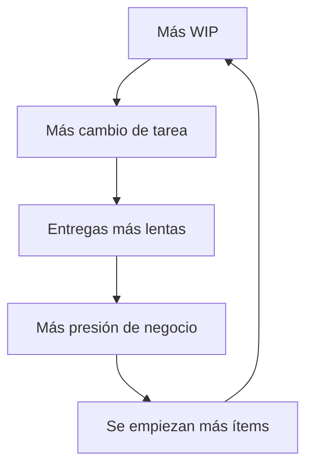

# Pensamiento sistémico

**En una frase:** Los resultados de un equipo salen de su estructura (reglas, metas, bucles y demoras) más que del esfuerzo de cada persona; para cambiarlos, cambia la estructura.

**Área:** Lean y flujo · **Lectura:** ~3 min

## Qué es

Donella Meadows define un sistema como un conjunto de elementos interconectados, organizados para cumplir una función o un propósito. Para leer un equipo bastan cuatro piezas:

- **Stocks:** lo que se acumula. Por ejemplo, el WIP, el backlog, los defectos abiertos o la deuda técnica.
- **Flujos:** lo que entra y sale de cada stock. Por ejemplo, los pedidos que llegan y los ítems que se entregan.
- **Bucles de realimentación:** los de **refuerzo** amplifican un cambio y los de **equilibrio** lo frenan.
- **Demoras:** el tiempo entre una acción y su efecto. Las demoras largas llevan a corregir de más.

Un bucle de refuerzo típico en equipos con demasiado trabajo en curso:

Peter Senge describió patrones que se repiten, los **arquetipos**. Dos aparecen seguido:

| Arquetipo | Cómo se ve en un equipo |
|---|---|
| Desplazar la carga | El héroe que apaga incendios evita arreglar la causa, y el equipo depende cada vez más de él |
| Límites al crecimiento | Se suman personas para ir más rápido y la coordinación termina frenando el avance |

## Para qué sirve (y cuándo no)

Sirve cuando el mismo problema vuelve después de cada "solución", y cuando la conversación busca culpables. Cambia la pregunta "¿quién falló?" por "¿qué parte del sistema produce este resultado?".

Meadows también ordenó los **puntos de apalancamiento**: cambiar números (más personas, otra meta de horas) mueve poco; cambiar reglas, flujos de información y metas del sistema mueve mucho más. Por eso una regla de pull con límites de WIP o hacer visible el lead time suelen pesar más que pedir más esfuerzo.

No sirve como excusa para analizar sin actuar. En una crisis, primero se estabiliza. Tampoco hace falta un diagrama para todo: si la causa es obvia y local, arréglala.

## Cómo se aplica

1. **Dibuja el comportamiento en el tiempo:** un gráfico simple de la métrica que preocupa en los últimos meses. Busca tendencias, no un dato suelto.
2. **Identifica los stocks** que suben o bajan, y qué los alimenta y los vacía.
3. **Dibuja el bucle con el equipo**, en no más de cinco o seis cajas. Si no cabe, estás mirando demasiado a la vez.
4. **Marca las demoras:** ¿cuánto tarda en verse el efecto de una decisión?
5. **Elige un punto de apalancamiento** por encima de "más gente" o "más horas": una regla, una información visible o una meta.
6. **Pruébalo como experimento** y observa el mismo gráfico durante varias semanas.

## Errores típicos

- Atribuir a personas resultados que produce la estructura.
- Repetir la solución rápida que alivia el síntoma y alimenta el problema.
- Cambiar una regla y evaluarla antes de que pase la demora.
- Fijar metas numéricas que el sistema cumple de forma creativa, sin mejorar nada.
- Diagramas tan grandes que nadie los usa para decidir.

## Qué observar al llegar a un equipo

- ¿Los mismos temas aparecen en retro tras retro?
- ¿Hay una persona sin la cual "no sale nada"?
- Cuando algo sale mal, ¿la primera pregunta es quién o qué?
- ¿Las metas del equipo chocan con las de otras áreas (ocupación contra entrega, por ejemplo)?
- ¿Las soluciones habituales son más gente, más control o más horas?
- ¿Cuánto tarda el equipo en ver el efecto de sus decisiones en los datos?

## Relacionado

- [Lean en una página](lean-en-una-pagina.md) · [Principios de flujo](principios-de-flujo.md) · [Los desperdicios en software](desperdicios.md)
- [STATIK](../kanban/statik.md) · [Sprint Retrospective](../scrum/retrospectiva.md) · [Ley de Little](../flujo/ley-de-little.md)
- [Retrospectiva basada en datos](../../caja-de-herramientas/retro-datos.md) · [Fase 6 · Mejora continua](../../fases/06-mejora-innovacion.md)

## Para profundizar

- Donella H. Meadows, *Thinking in Systems: A Primer*, editado por Diana Wright, Chelsea Green, 2008.
- Donella H. Meadows, *Leverage Points: Places to Intervene in a System*, The Sustainability Institute, 1999.
- Peter M. Senge, *The Fifth Discipline: The Art and Practice of the Learning Organization*, Doubleday, 1990.
