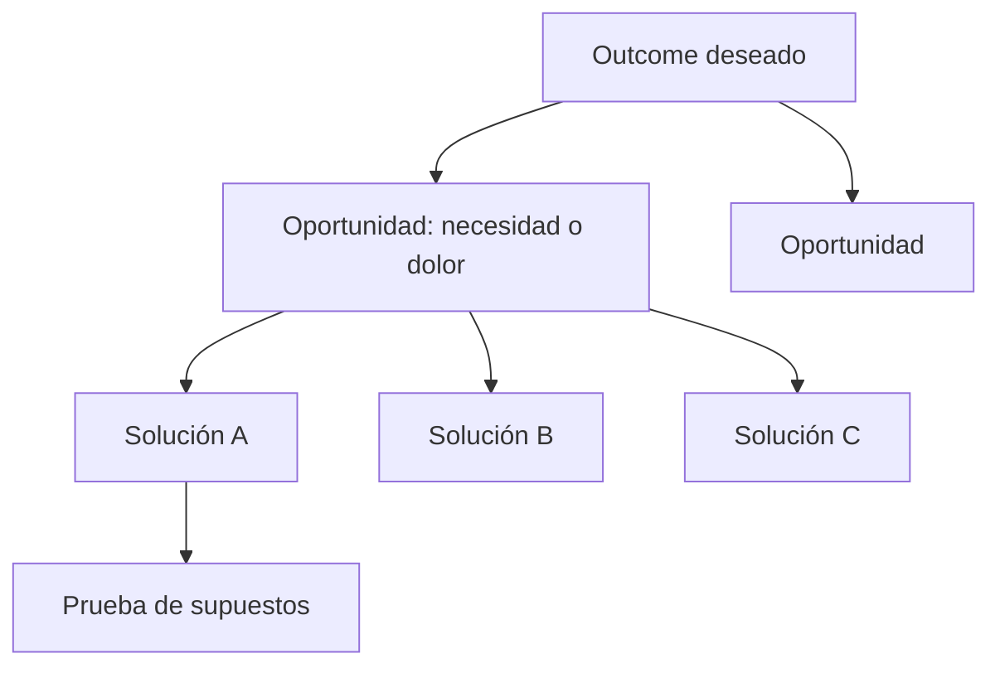

# Continuous discovery

**En una frase:** El mismo equipo que construye el producto conversa con clientes cada semana y hace pequeños experimentos para decidir qué construir, en vez de descubrir una vez al inicio y después solo entregar.

**Área:** Producto · **Lectura:** ~3 min

## Qué es

Teresa Torres lo define en *Continuous Discovery Habits* (2021) como, al menos, **contacto semanal con clientes por parte del equipo que construye el producto**, con pequeñas actividades de investigación orientadas a un resultado deseado. Tres palabras pesan:

- **Semanal:** no un estudio por trimestre, sino un hábito.
- **El equipo que construye:** no un área de investigación que entrega un informe. Torres habla del **trío de producto**: producto, diseño e ingeniería, responsables juntos de un mismo outcome.
- **Outcome:** se descubre para mover una métrica de negocio o de comportamiento, no para justificar una funcionalidad ya decidida.

Su herramienta central es el **opportunity solution tree** (árbol de oportunidades y soluciones), que Torres publica desde 2016:

Las **oportunidades** salen de las entrevistas, no de la lista de pedidos. Se elige una oportunidad y se comparan varias soluciones antes de construir una.

## Para qué sirve (y cuándo no)

Evita el antipatrón que ya advierte la [Fase 1](../../fases/01-descubrimiento.md): tratar el descubrimiento como una fase única. Mantiene vivo el backlog de hipótesis y le da al Product Owner evidencia fresca para ordenar el Product Backlog.

No aplica igual en todos los contextos. Un equipo de plataforma interna o de mantenimiento regulatorio tiene "clientes" distintos (otros equipos, un regulador) y conviene adaptar el contacto. Y sin un outcome acordado, el árbol se vuelve un mapa de ideas sin criterio para elegir.

## Cómo se aplica

1. **Acuerda el outcome** con quien patrocina el producto: un cambio medible, no una funcionalidad. El [roadmap por outcomes](../../caja-de-herramientas/roadmap-outcomes.md) es el lugar natural.
2. **Agenda entrevistas cada semana**, ojalá automatizando el reclutamiento. Pide historias concretas: "cuéntame la última vez que…", no opiniones sobre el futuro.
3. **Sintetiza** cada entrevista en pocas líneas y lleva las oportunidades al árbol.
4. **Elige una oportunidad** y genera varias soluciones para ella.
5. **Prueba los supuestos** más riesgosos de cada solución con el experimento más barato. La [tarjeta de hipótesis](../../caja-de-herramientas/lean-canvas-hipotesis.md) sirve para registrarlos.
6. **Lleva lo aprendido al refinamiento y a la Sprint Review.** El descubrimiento y la entrega comparten backlog y cadencia.

## Errores típicos

- El PO descubre solo y el equipo recibe historias cerradas.
- Entrevistas que presentan la solución y preguntan "¿lo usarías?".
- Un árbol con una sola solución por oportunidad: es una lista de funcionalidades con otro dibujo.
- Hablar con clientes "cuando hay tiempo", es decir, nunca.
- Medir el descubrimiento por la cantidad de entrevistas y no por las decisiones que cambiaron.

## Qué observar al llegar a un equipo

- ¿Cuándo habló alguien del equipo con un usuario real por última vez? ¿Quién fue?
- ¿Los Developers participan alguna vez en entrevistas o pruebas con usuarios?
- ¿Hay ítems en el backlog que nacieron de evidencia, o todos vienen de pedidos de stakeholders?
- ¿Alguna idea se descartó en los últimos meses por un experimento?
- ¿El equipo sabe qué outcome persigue, o solo qué funcionalidad entrega?

## Relacionado

- [Fase 1 · Descubrimiento de producto](../../fases/01-descubrimiento.md) · [Lean Canvas e hipótesis](../../caja-de-herramientas/lean-canvas-hipotesis.md)
- [Jobs to be Done](jtbd.md) · [Impact mapping](impact-mapping.md) · [OKRs](okrs.md)
- [Refinamiento del Product Backlog](../scrum/refinamiento.md) · [Sprint Review](../scrum/sprint-review.md)

## Para profundizar

- Teresa Torres, *Continuous Discovery Habits: Discover Products that Create Customer Value and Business Value*, Product Talk LLC, 2021.
- Teresa Torres, "Opportunity Solution Trees", artículo en [producttalk.org](https://www.producttalk.org/opportunity-solution-trees/), y la definición de [product trio](https://www.producttalk.org/product-trio/).
