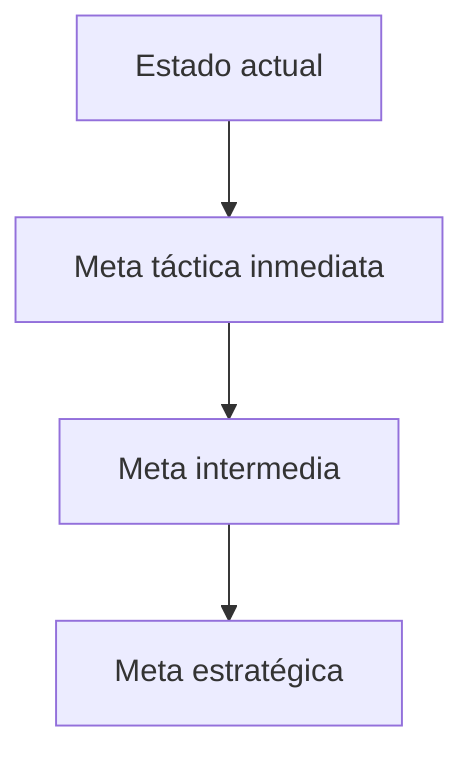

# Evidence-Based Management

**En una frase:** Un marco de Scrum.org para medir y mejorar el valor que entrega un producto, con metas por niveles y cuatro áreas clave de valor.

**Área:** Scrum · **Lectura:** ~3 min

## Qué es

Evidence-Based Management (EBM) es una guía de Scrum.org complementaria a Scrum; no forma parte de la Scrum Guide. Propone gestionar en condiciones de incertidumbre con **metas por niveles** y **experimentos cortos**, y mirar el valor desde cuatro **áreas clave de valor** (*Key Value Areas*):

| Área | Pregunta | Ejemplos de medidas |
|---|---|---|
| Current Value | ¿Qué valor entrega el producto hoy? | Satisfacción de usuarios, uso, ingresos |
| Unrealized Value | ¿Cuánto valor potencial falta capturar? | Necesidades no cubiertas, brecha de mercado |
| Time-to-Market | ¿Qué tan rápido entregamos y aprendemos? | Lead time, frecuencia de despliegue |
| Ability to Innovate | ¿Qué tan capaces somos de entregar algo nuevo? | Deuda técnica, tiempo en soporte o mantenimiento |

Los ejemplos son ilustrativos: elige medidas que tengan sentido para tu producto.

Las metas van de lo lejano a lo inmediato. Entre una y otra, el equipo avanza con un **ciclo de experimentos**: plantea una hipótesis, la prueba, mide e inspecciona.

## Para qué sirve (y cuándo no)

Sirve para salir de las métricas de actividad (story points, horas, tickets cerrados) y conversar sobre resultados. Las cuatro áreas obligan a mirar el equilibrio: acelerar el Time-to-Market a costa de la Ability to Innovate se paga después con deuda.

No sirve para comparar equipos, evaluar personas ni montar un programa de medición pesado. Si las medidas se usan para premiar o castigar, se distorsionan.

## Cómo se aplica

1. Escribe la meta estratégica y una meta intermedia medible con el PO y los stakeholders.
2. Define la meta táctica inmediata para las próximas semanas.
3. Elige **una o dos medidas por área**, con línea base. Revisa el [catálogo de métricas](../../caja-de-herramientas/catalogo-metricas.md) antes de inventar nuevas.
4. Formula hipótesis: "si hacemos X, esperamos que la medida Y cambie de A a B".
5. Inspecciona las medidas en la [Sprint Review](sprint-review.md) y ajusta el backlog o el [roadmap por outcomes](../../caja-de-herramientas/roadmap-outcomes.md).

## Errores típicos

- Medir solo una área, casi siempre Time-to-Market.
- Treinta indicadores que nadie mira.
- Usar la velocidad como medida de valor.
- Metas sin línea base: imposible saber si algo cambió.
- Tratar EBM como un reporte para la gerencia y no como herramienta del equipo y del PO.

## Qué observar al llegar a un equipo

- ¿Alguien puede decir qué significa "valor" para este producto, con un dato?
- ¿Las métricas visibles son de resultado o solo de actividad?
- ¿Cuánto tarda el equipo en saber si a los usuarios les sirvió lo entregado?
- ¿Qué proporción del tiempo se va en soporte, incidentes y mantenimiento?
- ¿Cuándo fue la última liberación a producción?
- ¿Las metas del producto tienen línea base y fecha de revisión?

## Relacionado

- [Sprint Review](sprint-review.md) · [Artefactos y compromisos](artefactos-y-compromisos.md)
- [Fase 5 · Medición y aprendizaje](../../fases/05-medicion.md) · [DORA](../ingenieria/dora.md)
- [Catálogo de métricas](../../caja-de-herramientas/catalogo-metricas.md) · [Lean Canvas e hipótesis](../../caja-de-herramientas/lean-canvas-hipotesis.md)
- [OKRs](../producto/okrs.md)

## Para profundizar

- Scrum.org, *The Evidence-Based Management Guide: Improving Value Delivery under Conditions of Uncertainty*, mayo de 2024. [scrum.org](https://www.scrum.org/resources/evidence-based-management-guide).
- Ken Schwaber y Jeff Sutherland, *The Scrum Guide*, noviembre de 2020. [scrumguides.org](https://scrumguides.org/scrum-guide.html).
