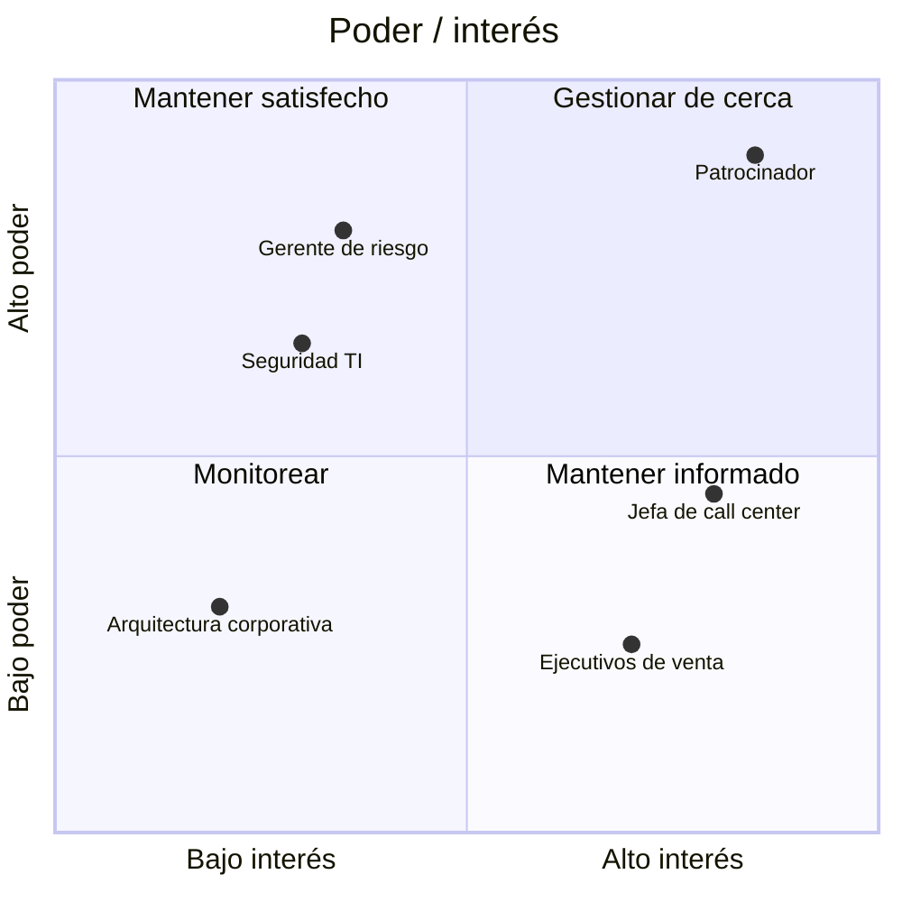

# Mapa de stakeholders

**Fase:** 0 · **Origen:** matriz poder / interés (Mendelow) · **Duración:** 1 a 1,5 horas para la primera versión

Se arma con el patrocinador y el PO después de la entrevista de negocio ([Fase 0, sección 0.1](../fases/00-diagnostico-onboarding.md#01-entender-el-negocio)). Sirve para decidir **a quién involucrar, cuánto y por qué canal**, no para clasificar personas.

## Matriz poder / interés

- **Poder**: capacidad de frenar, financiar o cambiar el rumbo del producto.
- **Interés**: cuánto le afecta el resultado o cuánto quiere participar.

| Cuadrante | Estrategia | Ejemplo de canal |
|---|---|---|
| Gestionar de cerca (alto poder, alto interés) | Involucrar en decisiones y revisiones | Revisión con negocio, comité trimestral |
| Mantener satisfecho (alto poder, bajo interés) | Consultar antes de decisiones que lo afectan; mensajes breves | Reunión 1:1 mensual, resumen ejecutivo |
| Mantener informado (bajo poder, alto interés) | Informar seguido y recoger feedback | Sprint Review abierta, boletín, entrevistas |
| Monitorear (bajo poder, bajo interés) | Información disponible, sin esfuerzo activo | Página del producto, roadmap publicado |

## Registro de stakeholders

| Stakeholder | Rol | Interés principal | Poder (A/M/B) | Interés (A/M/B) | Postura actual | Postura deseada | Estrategia | Cadencia de contacto | Responsable |
|---|---|---|---|---|---|---|---|---|---|
| Ana Pérez | Patrocinadora, Gerencia Comercial | Aumentar créditos cerrados en canal digital | A | A | Apoya | Lidera | Gestionar de cerca | Revisión con negocio cada sprint | PO |
| Luis Rojas | Gerente de riesgo | Que no suba la morosidad | A | M | Neutral | Apoya | Mantener satisfecho | 1:1 mensual | PO |
| Seguridad TI | Aprobador de pasos a producción | Cumplimiento de políticas | A | B | Resistente | Neutral | Mantener satisfecho; involucrar en DoD | Al definir la DoD y cada trimestre | Tech Lead |
| Jefa de call center | Usuaria indirecta | Menos llamadas por trámites | M | A | Apoya | Apoya | Mantener informado | Sprint Review | PO |

Posturas sugeridas: **Resistente · Neutral · Apoya · Lidera**. La brecha entre postura actual y deseada define el esfuerzo.

!!! tip "Una postura resistente es información"
    Detrás de una resistencia suele haber un riesgo real (regulatorio, operativo, político). Conversa el riesgo; no intentes "convencer".

## Cómo actualizarlo

- **Cuándo**: al cerrar la Fase 0, en cada comité trimestral y cuando entra o sale una persona clave (reorganización, cambio de patrocinador).
- **Quién**: el PO es dueño; el SM / Coach facilita; el patrocinador valida.
- **Qué revisar**: ¿alguien cambió de cuadrante?, ¿la postura se movió hacia la deseada?, ¿se cumplió la cadencia de contacto?
- **Dónde vive**: en el espacio del equipo, con acceso restringido si contiene posturas sensibles. El registro **no se publica** junto al roadmap.

!!! warning "Antipatrón"
    Gestionar solo hacia arriba. Los usuarios y quienes operan el producto suelen quedar en "mantener informado" y son los que más evidencia aportan.
