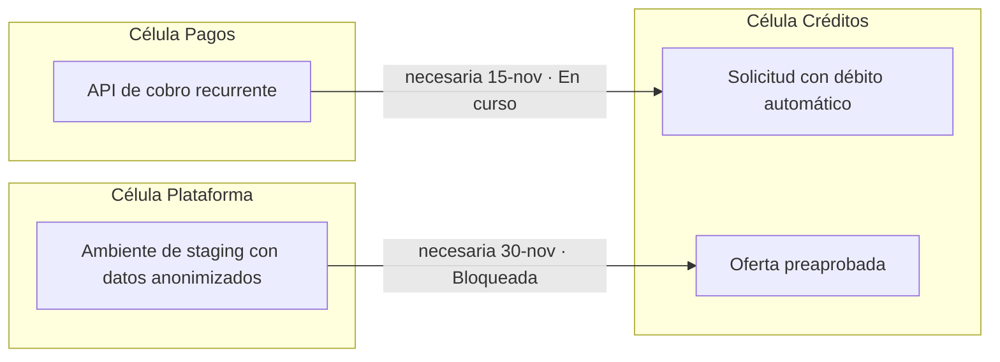

# Tablero de dependencias entre células

**Fase:** 6 (sección 6.5, escalamiento) · **Revisión:** sincronización de PO semanal y revisión de operaciones · **Responsable:** PO de cada célula, facilitado por un SM / Coach

Cuando hay dos o más células, las dependencias son la principal fuente de espera. El tablero las hace visibles **antes** de que bloqueen ([Fase 6, sección 6.5](../fases/06-mejora-innovacion.md#65-escalamiento)).

## Formato

Una fila (carril) por célula; cada dependencia es una tarjeta que une a quien la **necesita** con quien la **provee**.

| ID | Necesita | Provee | Qué se necesita | Clase | Fecha necesaria | Fecha comprometida | Estado | Riesgo |
|---|---|---|---|---|---|---|---|---|
| D-12 | Créditos | Pagos | API de cobro recurrente | Entrega | 15-nov | 12-nov | En curso | Bajo |
| D-13 | Créditos | Plataforma | Staging con datos anonimizados | Recurso | 30-nov | — | Bloqueada | Alto |
| D-14 | Pagos | Seguridad TI | Revisión de cifrado de tarjetas | Aprobación | 20-nov | 22-nov | Acordada | Medio |

Estados: **Identificada → Acordada → En curso → Entregada**, más **Bloqueada** con motivo y fecha.

## Clases de dependencia

| Clase | Ejemplo | Cómo se gestiona |
|---|---|---|
| Entrega | Otra célula construye una API o un cambio | Se negocia en la sincronización de PO y entra al backlog de quien provee |
| Recurso o ambiente | Infraestructura, datos, licencias compartidas | Idealmente autoservicio de la plataforma |
| Aprobación | Seguridad, arquitectura, legal | Criterios conocidos de antemano e incluidos en la DoD |
| Conocimiento | Solo una persona de otra célula sabe cómo funciona algo | Pareo y documentación; se registra en el mapa de conocimiento |
| Externa | Proveedor o tercero fuera de la organización | Fecha comprometida por escrito y plan alternativo |

## Política de escalamiento

1. Toda dependencia con **fecha necesaria** se registra al identificarse, no cuando bloquea.
2. Si a **5 días hábiles** de la fecha necesaria no está "En curso", los PO de ambas células la conversan en 48 horas.
3. Sin acuerdo, se lleva a la **sincronización de PO** de esa semana.
4. Si sigue sin resolverse o afecta un outcome del roadmap, se escala a la **revisión de operaciones** o al patrocinador, con las opciones y su costo de demora.

## Revisión en la revisión de operaciones

- Dependencias bloqueadas o en riesgo, de derecha a izquierda del tablero.
- Métricas del periodo y su tendencia.
- Pares de células con dependencias recurrentes: candidatas a rediseño.

## Métricas

| Métrica | Cálculo | Uso |
|---|---|---|
| % de ítems bloqueados por dependencias externas | Ítems terminados que estuvieron bloqueados por otra célula o tercero ÷ ítems terminados | Medir el acoplamiento entre células |
| Tiempo bloqueado por dependencia | Días en estado Bloqueado, en percentil 85 | Costo de la dependencia en el lead time |
| Dependencias entregadas a tiempo | Entregadas antes de la fecha necesaria ÷ total | Confiabilidad entre células |

Si más del 20 % de los ítems se bloquea por dependencias, el problema es de diseño organizacional, no de coordinación.

## Cómo reducir dependencias

- **Dividir por dominio o flujo de valor**, no por capa técnica: cada célula lleva un cambio de punta a punta.
- **Plataforma como autoservicio**: ambientes, pipelines y datos de prueba sin tickets.
- **Contratos de API versionados** para que cada célula avance sin esperar a la otra.
- **Inner source**: la célula que necesita el cambio lo hace en el código de la otra, con su revisión.
- **Mover personas o conocimiento** cuando la dependencia es de una sola persona.

!!! warning "Antipatrón"
    Un tablero de dependencias que crece cada mes no es éxito de coordinación: es la señal de que las células están mal cortadas.
