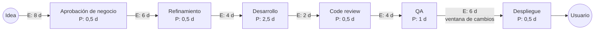

# Value Stream Mapping

**Fase:** 6, cada 3–6 meses · **Duración:** taller de 3 a 4 horas · **Participantes:** PO, Tech Lead, equipo, y quienes intervienen fuera de la célula (aprobadores, operaciones, seguridad)

Mapea el flujo de valor completo, de la idea al usuario, para encontrar dónde espera el trabajo ([Fase 6, sección 6.2](../fases/06-mejora-innovacion.md#62-value-stream-mapping)).

## Pasos del taller

1. **Acotar el flujo**: un tipo de ítem (por ejemplo, historia estándar), con punto de inicio y de fin claros.
2. **Listar las etapas reales**, incluidas las que ocurren fuera de la célula (aprobaciones, comités, ventanas de despliegue).
3. **Anotar por etapa** el tiempo de proceso (trabajo activo) y el tiempo de espera previo. Usa medianas de los datos, no el mejor caso.
4. **Calcular** lead time total y eficiencia de flujo.
5. **Marcar las 2–3 esperas más grandes** y buscar su causa (5 porqués).
6. **Dibujar el mapa futuro** y convertir cada cambio en un experimento del backlog de mejora.

## Mapa actual (ejemplo)

Tiempos en días hábiles. **P** = proceso, **E** = espera antes de la etapa.

| Etapa | Proceso | Espera |
|---|---|---|
| Aprobación de negocio | 0,5 | 8 |
| Refinamiento | 0,5 | 6 |
| Desarrollo | 2,5 | 4 |
| Code review | 0,5 | 2 |
| QA | 1 | 4 |
| Despliegue | 0,5 | 6 |
| **Total** | **5,5** | **30** |

- **Lead time total** = 5,5 + 30 = **35,5 días**.
- **Eficiencia de flujo** = tiempo activo ÷ lead time total = 5,5 ÷ 35,5 = **15,5 %**.

Más del 80 % del tiempo el ítem está esperando. Acelerar el desarrollo no cambia casi nada; reducir esperas, sí.

## Mapa futuro (ejemplo)

| Cambio | Etapa afectada | Espera antes → después |
|---|---|---|
| El PO aprueba ítems estándar (sube nivel en el [Delegation Board](delegation-board.md)) | Aprobación | 8 → 2 |
| Refinamiento semanal con DoR | Refinamiento | 6 → 3 |
| Límites de WIP y "empezar por la derecha" | Desarrollo | 4 → 2 |
| Revisión en pareja el mismo día | Code review | 2 → 0,5 |
| Pruebas automatizadas en el pipeline; QA dentro de la célula | QA | 4 → 1 (proceso 1 → 0,5) |
| Cambios estándar sin ventana de cambios | Despliegue | 6 → 0,5 |

Resultado: proceso 5 d, espera 9 d, lead time 14 d, eficiencia **5 ÷ 14 = 35,7 %**.

!!! tip "Un cambio a la vez"
    El mapa futuro es una dirección, no un plan. Lleva los cambios al backlog de mejora respetando el máximo de 1 a 2 mejoras en curso.

## De dónde sacar los datos

- **Jira**: el historial de cambios de estado (*changelog*) de cada issue, vía exportación, API o un reporte de control. Calcula el tiempo en cada estado.
- **Azure DevOps**: Analytics (OData o Power BI) con las revisiones del work item y la fecha de cada cambio de estado.
- **Pipeline**: tiempos de espera entre aprobación y despliegue.
- **Fuera de las herramientas**: las aprobaciones por correo o comité se reconstruyen con fechas de 10–20 ítems recientes.

!!! warning "Tablero sin columnas de espera"
    Si el tablero no distingue **en curso / listo** ([Fase 3, sección 3.3](../fases/03-sistema-de-trabajo.md#33-disenar-el-tablero)), el historial mezcla proceso y espera. Completa con estimaciones del equipo en el taller y corrige el tablero.
