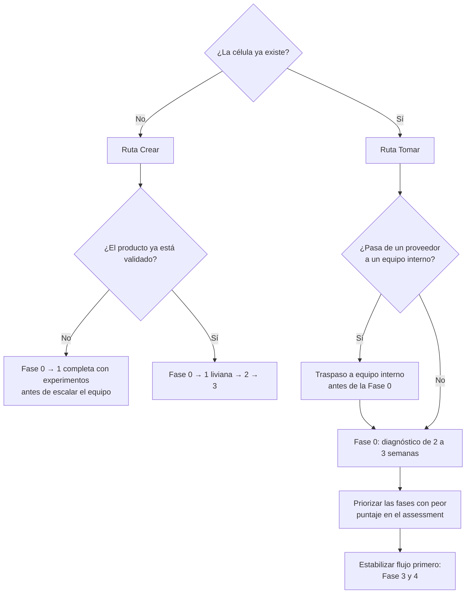

# Cómo usar la guía

## Elige tu ruta

Cada ruta tiene un caso de ejemplo: [Crear una célula](casos/crear-celula.md), [Tomar una célula](casos/tomar-celula.md) y [Traspaso de proveedor](casos/traspaso-proveedor.md).

## Tiempos de referencia

| Fase | Crear (célula nueva) | Tomar (célula existente) |
|---|---|---|
| 0 · Diagnóstico y onboarding | 1–2 semanas | 2–3 semanas |
| 1 · Descubrimiento | 2–6 semanas (hasta validar MVO) | 1–2 semanas de revisión |
| 2 · Fundaciones técnicas | 2–4 semanas (*sprint 0* extendido) | Plan de remediación incremental |
| 3 · Sistema de trabajo | 1 semana + ajuste continuo | 1–2 semanas |
| 4 · Entrega continua | Continua | Continua |
| 5 · Medición | Línea base en 4–6 semanas | Línea base en 2 semanas (hay historia) |
| 6 · Mejora e innovación | Continua desde el mes 2 | Continua |

Un [traspaso de proveedor a equipo interno](fases/transversal-traspaso-proveedor.md) suma de 3 a 6 meses antes de que el equipo interno retome la Fase 0.

!!! warning "Los tiempos son referencia, no compromiso"
    Una fase termina cuando cumple sus **criterios de salida**, no cuando vence el plazo.

## Principios de uso

- **Adapta, no adoptes.** Cada célula tiene su contexto. Registra las adaptaciones como ADRs de proceso.
- **Empieza por donde duele.** En una célula existente, el diagnóstico decide el orden.
- **Lotes pequeños también para la guía.** No implementes todas las herramientas a la vez; introduce una o dos por iteración.
- **Mide antes de cambiar.** Toma una línea base antes de cualquier intervención para poder demostrar mejora.

!!! tip "Para llevar la guía a una reunión"
    La [versión imprimible](../print_page/) reúne todas las páginas en un solo documento que puedes guardar como PDF desde el navegador.

## Cómo iterar esta guía

La guía es un producto. Si algo no funciona en una célula real, abre un *issue* con la plantilla **Propuesta de mejora** o un *pull request*. Ver [Contribuir](contribuir.md).
