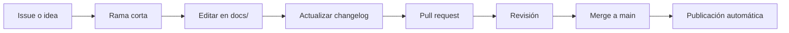

# Contribuir

Esta guía mejora con la experiencia de células reales. Toda contribución es bienvenida.

## Formas de contribuir

1. **Proponer una mejora:** abre un *issue* con la plantilla **Propuesta de mejora**.
2. **Editar directamente:** usa el ícono de lápiz ✏️ en cualquier página; GitHub crea un pull request.
3. **Cambios grandes:** crea una rama, edita en local con `mkdocs serve` y abre un pull request.

## Flujo de trabajo

## Convenciones

- Cada fase mantiene la estructura: objetivo, entradas, actividades, artefactos, métricas, roles, criterios de salida y antipatrones.
- Los diagramas se escriben en **Mermaid** dentro del Markdown.
- Las plantillas nuevas van en `docs/caja-de-herramientas/` y se agregan al índice y a `mkdocs.yml`.
- Todo cambio de contenido actualiza `docs/changelog.md`.
- El build debe pasar en modo estricto: `mkdocs build --strict`.
