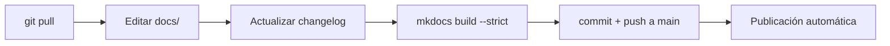

# Contribuir

Esta guía mejora con la experiencia de células reales.

## Flujo del mantenedor: directo a `main`

El mantenedor publica los cambios directamente en `main`. Cada push dispara el workflow, que valida el sitio en modo estricto y lo publica en GitHub Pages.



### Preparar el entorno (una sola vez)

```bash
python3 -m venv .venv
source .venv/bin/activate
pip install -r requirements.txt
```

### Cada cambio

```bash
source .venv/bin/activate      # en cada terminal nueva
git pull                       # trae ediciones hechas desde la web
# editar archivos en docs/ y actualizar docs/changelog.md
mkdocs serve                   # opcional: ver en http://127.0.0.1:8000
mkdocs build --strict          # debe terminar sin WARNING ni ERROR
git add .
git commit -m "Descripción corta del cambio"
git push
```

!!! warning "Sin revisión previa"
    Al publicar directo en `main`, el build estricto en local es la única barrera antes de que el cambio llegue al repositorio. Si el workflow falla, la web no se actualiza y la pestaña **Actions** muestra el error.

## Contribuciones de otras personas

Quien no mantiene el repositorio contribuye por pull request:

1. **Proponer una mejora:** abrir un *issue* con la plantilla **Propuesta de mejora**.
2. **Editar desde la web:** el ícono de lápiz ✏️ de cada página crea un pull request automáticamente.
3. **Cambios grandes:** hacer *fork*, editar en local y abrir un pull request.

El workflow valida el build de cada pull request antes del merge.

## Convenciones

- Cada fase mantiene la estructura: objetivo, entradas, actividades, artefactos, métricas, roles, criterios de salida y antipatrones.
- Los diagramas se escriben en **Mermaid** dentro del Markdown.
- Las plantillas nuevas van en `docs/caja-de-herramientas/` y se agregan al índice y a `mkdocs.yml`.
- Las preguntas del assessment viven en `assessment-madurez.md`; si cambian, se actualiza su texto corto en `docs/assets/js/assessment.js`.
- Todo cambio de contenido actualiza `docs/changelog.md`.
- Versionado: **mayor** si cambia la estructura de fases, **menor** si se agrega contenido o herramientas, **parche** para correcciones.
