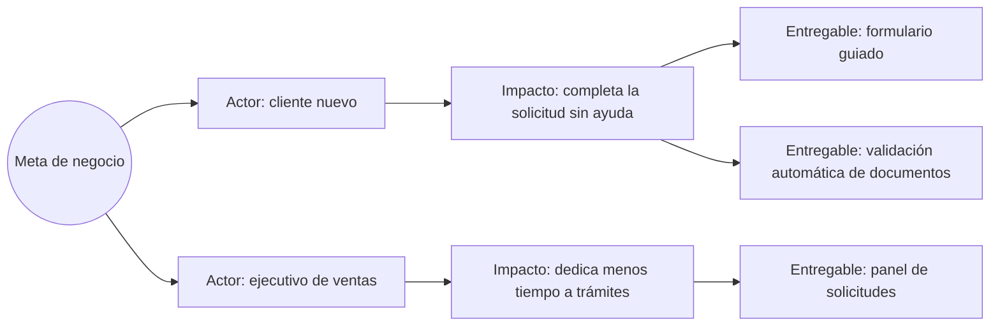

# Fase 1 · Descubrimiento de producto

## Objetivo de negocio

Reducir la incertidumbre antes de invertir en construcción: definir el problema, las hipótesis de valor y el **MVO** (*Minimum Viable Outcome*), y traducirlo a un backlog ordenado por el recorrido del usuario.

!!! info "MVO y MVP"
    - **MVO (Minimum Viable Outcome)**: el cambio mínimo y medible en el comportamiento del usuario o del negocio que valida la apuesta. *Ejemplo: 20 % de los clientes que solicitan un crédito lo completan sin llamar al call center.*
    - **MVP (Minimum Viable Product)**: el vehículo mínimo que construimos para intentar lograr ese outcome.

    Primero se define el MVO; el MVP se diseña para alcanzarlo. Un MVP sin MVO es solo una versión pequeña del producto.

    Ejemplo completo en el caso [Crear una célula](../casos/crear-celula.md).

## Entradas

- Objetivo de negocio de la Fase 0.
- Acceso a usuarios reales o sus representantes.
- Datos existentes: analítica, tickets de soporte, encuestas.

## Actividades

### 1.1 Entender el problema

1. **Entrevistas de problema** con 5–8 usuarios (no se presenta la solución).
2. Mapear el **journey actual** y sus puntos de dolor.
3. Completar el **Lean Canvas** con el patrocinador y el PO.

### 1.2 Conectar negocio con producto: Impact Mapping

Cada entregable del backlog debe poder rastrearse hasta una meta de negocio. Si no se puede, se cuestiona.

### 1.3 Formular hipótesis

Formato: *Creemos que **[entregable]** para **[actor]** logrará **[impacto]**. Sabremos que es cierto cuando veamos **[métrica]** alcanzar **[umbral]** en **[plazo]**.*

Priorizar hipótesis por **riesgo × valor** y validar primero las más riesgosas con el experimento más barato posible (prototipo, *fake door*, Mago de Oz, concierge).

Cuando hay que ordenar entregables ya validados que compiten por la misma capacidad, usar [Cost of Delay y WSJF](../caja-de-herramientas/cost-of-delay-wsjf.md) para hacer explícito el costo económico de esperar.

### 1.4 User Story Map

1. Definir la **columna vertebral**: actividades del usuario de izquierda a derecha.
2. Bajo cada actividad, listar tareas e historias.
3. Trazar **líneas horizontales de release**: la primera línea es el MVP que persigue el MVO.
4. Validar el mapa con usuarios y equipo técnico.

Ver [plantilla de User Story Map](../caja-de-herramientas/user-story-map.md).

### 1.5 Roadmap por outcomes

Roadmap en formato **Ahora / Siguiente / Después**, expresado en problemas y outcomes, no en fechas y funcionalidades. Ver [plantilla de roadmap por outcomes](../caja-de-herramientas/roadmap-outcomes.md).

## Artefactos

| Artefacto | Plantilla |
|---|---|
| Lean Canvas | [Plantilla](../caja-de-herramientas/lean-canvas-hipotesis.md) |
| Impact Map | Diagrama de esta página |
| Backlog de hipótesis | [Plantilla](../caja-de-herramientas/lean-canvas-hipotesis.md) |
| User Story Map con releases | [Plantilla](../caja-de-herramientas/user-story-map.md) |
| Roadmap Ahora / Siguiente / Después | [Plantilla](../caja-de-herramientas/roadmap-outcomes.md) |

## Métricas

- Número de hipótesis validadas / invalidadas por mes (aprender rápido es éxito).
- Costo y tiempo por experimento.
- Porcentaje del backlog trazable a una meta de negocio.
- Cuando el MVP esté en producción: la métrica del MVO.

## Roles

| Actividad | Patrocinador | PO | Equipo | UX | SM / Coach |
|---|---|---|---|---|---|
| Lean Canvas | C | R/A | C | C | F |
| Hipótesis y experimentos | I | A | R | R | F |
| User Story Map | I | A | R | R | F |

*F = facilita.*

## Criterios de salida

- [ ] MVO definido con métrica, umbral y plazo.
- [ ] Hipótesis más riesgosa validada o descartada con evidencia.
- [ ] User Story Map con la primera línea de release acordada.
- [ ] Roadmap por outcomes aprobado por el patrocinador.
- [ ] Backlog de las primeras 2–4 semanas refinado y estimado (o dimensionado).

## Antipatrones

- **El backlog es una lista de funcionalidades pedidas** por stakeholders sin hipótesis detrás.
- **MVP que nunca es mínimo**: se agregan funcionalidades "por si acaso".
- **Descubrimiento como fase única**: después del arranque, debe volverse continuo.
- **Validar con opiniones internas** en vez de con usuarios reales.
