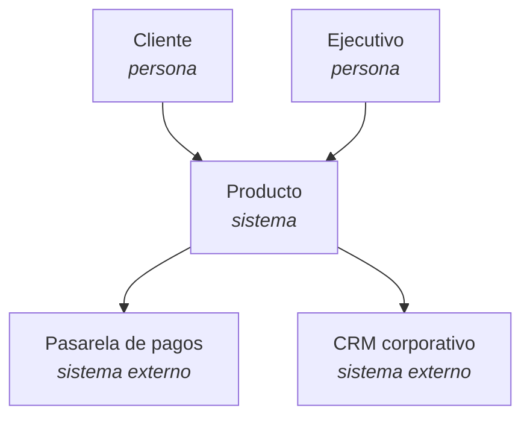
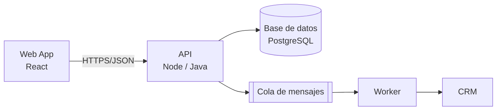
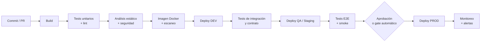

# Fase 2 · Fundaciones técnicas

## Objetivo de negocio

Que el costo y el riesgo de llevar un cambio a producción sean **bajos y predecibles**. Sin estas fundaciones, cada entrega es cara y lenta, y el negocio deja de experimentar.

## Entradas

- MVP y primera línea de release del User Story Map.
- Restricciones técnicas y de seguridad de la organización.
- Stack tecnológico existente (célula existente) o lineamientos corporativos.

## Actividades

### 2.1 Arquitectura con el modelo C4

Documentar solo los niveles que aportan, como código (Mermaid o Structurizr) y versionados en el repo del producto.

**Nivel 1 · Contexto**: el sistema, sus usuarios y los sistemas externos.

**Nivel 2 · Contenedores**: aplicaciones, APIs, bases de datos y cómo se comunican.

Los niveles 3 (componentes) y 4 (código) solo se documentan para partes críticas o complejas.

### 2.2 Decisiones de arquitectura (ADR)

Toda decisión difícil de revertir se registra como **ADR** en `docs/adr/` del repo del producto: contexto, decisión, alternativas y consecuencias. Ver [plantilla ADR](../caja-de-herramientas/adr.md).

### 2.3 Dockerización

- Cada servicio tiene su `Dockerfile` (multi-stage, imagen base mínima, usuario no root).
- `docker-compose.yml` para levantar el entorno completo en local con **un solo comando**.
- Las imágenes se construyen una vez en CI y **la misma imagen** se promueve entre ambientes (*build once, deploy many*).
- Configuración por variables de entorno; secretos en un gestor de secretos, nunca en la imagen.

### 2.4 Pipeline de integración y entrega continua

Reglas mínimas:

- **Trunk-based development** o ramas de vida corta (menos de 2 días).
- El pipeline corre en cada PR; no se integra código con pipeline en rojo.
- Pipeline completo hasta staging en menos de 15 minutos como meta.
- **Feature flags** para separar despliegue de liberación.
- Controles de seguridad en el pipeline (secretos, dependencias, imágenes) que generan evidencia para auditoría. Ver [seguridad en el flujo](../caja-de-herramientas/seguridad-en-el-flujo.md).

### 2.5 Estrategia de QA

Calidad integrada en el flujo, no como fase al final. Pirámide de pruebas:

| Nivel | Proporción | Quién | Cuándo |
|---|---|---|---|
| Unitarias | Base amplia | Desarrolladores | En cada commit |
| Integración / contrato | Media | Desarrolladores + QA | En cada PR |
| E2E (flujos críticos) | Pocas | QA | En staging |
| Exploratorias | Por historia | QA + PO | Antes de cerrar la historia |
| No funcionales (carga, seguridad) | Periódicas | QA + DevOps | Por release o mensualmente |

El rol de QA se transforma: de "probar al final" a **definir criterios de aceptación con el PO** (BDD / *three amigos*) y automatizar.

### 2.6 Ambientes y observabilidad

- Ambientes mínimos: local, DEV, QA/Staging, PROD. Lo más parecidos posible entre sí (infraestructura como código).
- Logs estructurados, métricas técnicas y trazas desde el primer despliegue.
- Alertas sobre síntomas que afectan al usuario, no sobre cada métrica.

### 2.7 Acuerdos de calidad

Definir **Definition of Ready** y **Definition of Done** con el equipo. Ver [plantilla DoR / DoD](../caja-de-herramientas/dor-dod.md).

## Artefactos

| Artefacto | Dónde vive |
|---|---|
| Diagramas C4 (niveles 1 y 2) | Repo del producto, `docs/arquitectura/` |
| ADRs | Repo del producto, `docs/adr/` |
| Dockerfiles y docker-compose | Repo del producto |
| Pipeline CI/CD | Repo del producto (`.github/workflows`, `.gitlab-ci.yml`, Azure Pipelines) |
| Estrategia de QA | Esta guía + repo del producto |
| DoR / DoD | [Plantilla](../caja-de-herramientas/dor-dod.md) |
| Controles de seguridad y evidencia | [Seguridad en el flujo](../caja-de-herramientas/seguridad-en-el-flujo.md) |

## Métricas

- Tiempo del pipeline (commit → staging).
- Porcentaje de builds en verde en `main`.
- Tiempo para levantar el entorno local de cero (meta: menos de 30 minutos).
- Cobertura de pruebas en código nuevo (como indicador, no como meta absoluta).
- Vulnerabilidades críticas abiertas.

## Roles

| Actividad | Tech Lead | Equipo | QA | DevOps / Plataforma | PO |
|---|---|---|---|---|---|
| Arquitectura C4 y ADRs | A | R | C | C | I |
| Docker y CI/CD | A | R | C | R | I |
| Estrategia QA | C | R | A | C | C |
| DoR / DoD | C | R | R | C | A |

## Criterios de salida

- [ ] Diagramas C4 niveles 1 y 2 publicados.
- [ ] Al menos un ADR registrado (stack o arquitectura).
- [ ] `docker compose up` levanta el entorno completo.
- [ ] Pipeline despliega automáticamente hasta staging.
- [ ] Un cambio trivial ("hola mundo") llegó a producción por el pipeline (*walking skeleton*).
- [ ] DoR y DoD acordadas y publicadas.

## Antipatrones

- **Sprint 0 eterno**: diseñar todo antes de entregar algo. El *walking skeleton* debe llegar a producción en semanas.
- **QA como embudo final**: un QA probando manualmente todo al final del sprint.
- **Ramas de larga duración** y "semana de integración".
- **Ambientes distintos** entre staging y producción ("en QA funcionaba").
- **Arquitectura en un PowerPoint** que nadie actualiza.
