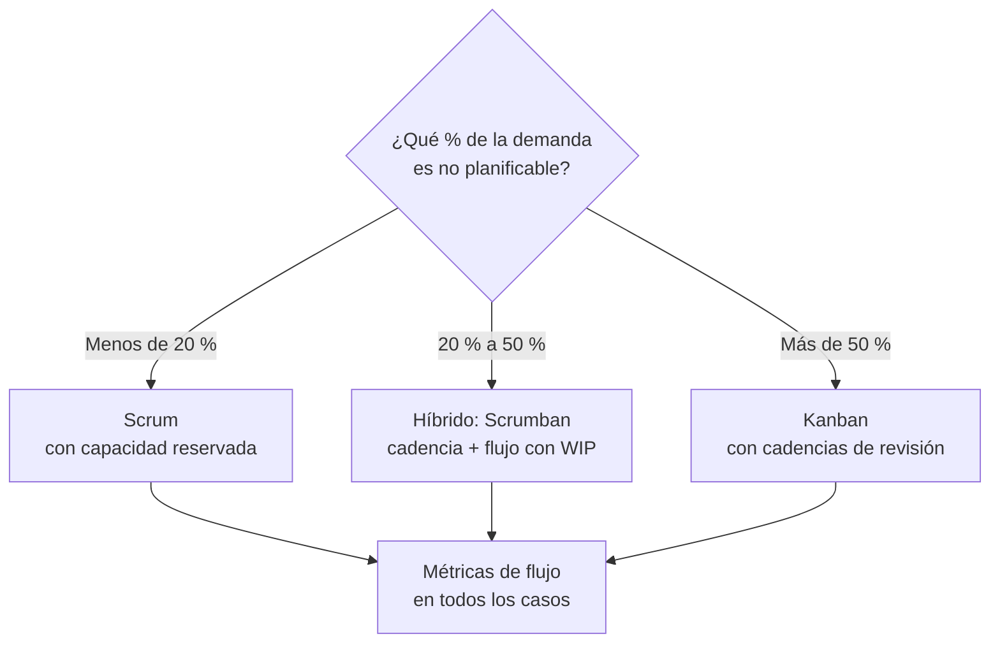

# Fase 3 · Diseño del sistema de trabajo

## Objetivo de negocio

Diseñar cómo fluye el trabajo para que el negocio reciba valor de forma **predecible**, con el mínimo de esperas, interrupciones y retrabajo.

## Entradas

- Assessment de Fase 0 (célula existente).
- Tipos de demanda que recibe la célula.
- Backlog inicial de Fase 1.

## Actividades

### 3.1 Analizar la demanda

Clasificar el trabajo que llega durante 2–4 semanas (o desde el historial):

| Tipo de demanda | Ejemplo | Naturaleza |
|---|---|---|
| Evolución de producto | Nuevas funcionalidades del roadmap | Planificable |
| Experimentos | Validación de hipótesis | Planificable, alta incertidumbre |
| Soporte / incidentes | Errores en producción | No planificable, urgente |
| Hotfix | Corrección crítica | No planificable, expedita |
| Deuda técnica / mejora | Refactor, actualización de librerías | Planificable |

### 3.2 Elegir el marco según la demanda

!!! note "Independiente del marco"
    En todos los casos se usan **métricas de flujo**, **límites de WIP** y **políticas explícitas**. Lo que cambia es si el compromiso es por *sprint* (Scrum) o por *nivel de servicio* (Kanban).

### 3.3 Diseñar el tablero

1. Mapear el **flujo de valor real** (*value stream*): desde la idea hasta producción y validación.
2. Columnas que reflejen estados reales, con distinción **en curso / listo** para visibilizar esperas.
3. **Límites de WIP** por columna (punto de partida: número de personas en la etapa × 1,5, luego ajustar).
4. **Clases de servicio**: Expedito, Fecha fija, Estándar, Intangible (deuda, mejora).
5. Carriles (*swimlanes*) por tipo de demanda si aplica.

Ejemplo de flujo:

`Opciones → Refinado (listo) → En desarrollo → Code review → En QA → Listo para prod → En producción → Validado`

### 3.4 Políticas explícitas

Escribir las reglas del tablero visibles para todos: cuándo un ítem entra, cuándo puede moverse, quién lo mueve, qué hace un expedito. Ver [plantilla de políticas](../caja-de-herramientas/politicas-tablero.md).

### 3.5 Cadencias

| Cadencia | Scrum | Kanban | Propósito |
|---|---|---|---|
| Diaria (15 min) | Daily Scrum | Kanban meeting | Coordinar el flujo, de derecha a izquierda del tablero |
| Refinamiento | Semanal | Reposición según demanda | Preparar ítems que cumplan DoR |
| Planificación | Sprint Planning | Reunión de reposición | Comprometer objetivo o seleccionar siguientes ítems |
| Revisión | Sprint Review | Revisión de entrega | Mostrar valor y recoger feedback de negocio |
| Retrospectiva | Cada sprint | Cada 2–4 semanas | Mejorar el sistema |
| Revisión de servicio | — | Mensual | Revisar métricas contra niveles de servicio |
| Revisión de operaciones | Mensual o trimestral | Mensual o trimestral | Alinear con otras células y negocio |

### 3.6 Capacidad para lo no planificado

Reservar capacidad explícita para soporte y deuda (por ejemplo, 70 % producto, 20 % soporte, 10 % deuda). Ajustar según los datos reales cada mes.

## Artefactos

| Artefacto | Plantilla |
|---|---|
| Mapa de flujo de valor | — |
| Tablero configurado con WIP y clases de servicio | Jira / Azure DevOps |
| Políticas explícitas | [Plantilla](../caja-de-herramientas/politicas-tablero.md) |
| Calendario de cadencias | — |
| Acuerdos de capacidad | — |

## Métricas

- WIP total y por columna.
- Porcentaje de trabajo no planificado.
- Edad de los ítems en curso (*WIP aging*).
- Número de ítems bloqueados y tiempo bloqueado.

## Criterios de salida

- [ ] Demanda clasificada y marco elegido con su justificación (ADR de proceso).
- [ ] Tablero refleja el flujo real, con límites de WIP.
- [ ] Políticas explícitas publicadas junto al tablero.
- [ ] Cadencias en el calendario de todas las personas.
- [ ] Reserva de capacidad acordada con el PO.

## Antipatrones

- **Tablero de tareas en vez de flujo de valor** (columnas "Hacer / Haciendo / Hecho" sin reflejar esperas).
- **WIP sin límite**: todos ocupados, nada terminado.
- **Daily como reporte de estado** a la jefatura.
- **Scrum por defecto** en un equipo cuya demanda es mayoritariamente soporte.
- **Políticas implícitas**: cada persona tiene su propia regla.
