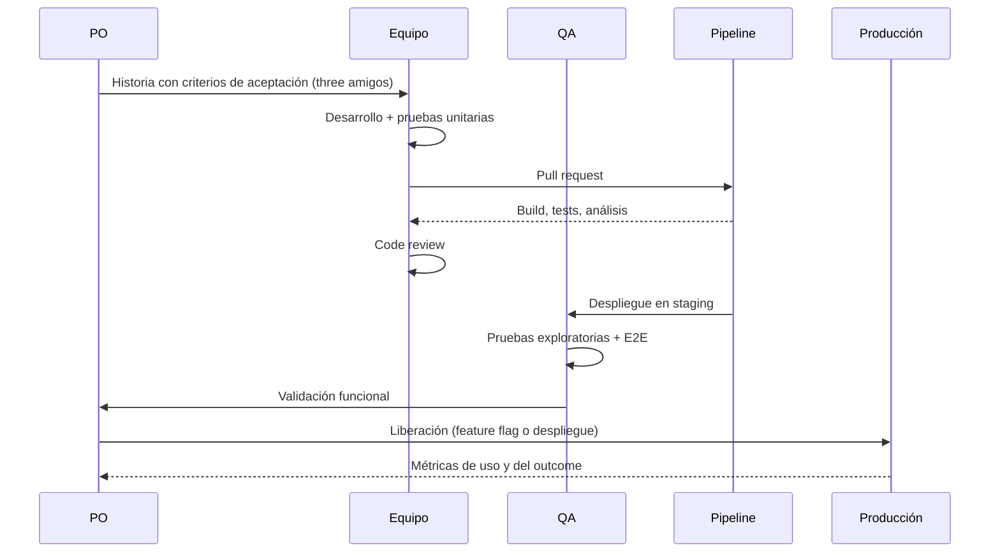

# Fase 4 · Entrega continua de valor

## Objetivo de negocio

Llevar valor a producción **en lotes pequeños, con frecuencia y bajo riesgo**, y confirmar con datos que el valor llegó al usuario.

## Entradas

- Fundaciones técnicas operativas (Fase 2).
- Sistema de trabajo definido (Fase 3).
- Backlog refinado y conectado a outcomes (Fase 1).

## Actividades

### 4.1 Ciclo de vida de un ítem

### 4.2 Trabajar en lotes pequeños

- Historias que se completan en **1 a 3 días**. Si es más grande, se divide (por flujo, regla de negocio, datos, interfaz, rendimiento).
- Un ítem empieza solo si hay capacidad dentro del WIP: **dejar de empezar, empezar a terminar**.
- Swarming: ante un bloqueo, el equipo se junta para destrabar antes de tomar algo nuevo.

### 4.3 Estrategias de liberación

| Estrategia | Cuándo usarla | Riesgo |
|---|---|---|
| Despliegue directo | Cambios pequeños y bien probados | Bajo con buen pipeline |
| Feature flag | Separar despliegue de liberación; probar con grupos | Muy bajo |
| Canary | Cambios de alto riesgo; liberar a un % del tráfico | Bajo |
| Blue / Green | Cambios de infraestructura; rollback instantáneo | Bajo, más costo |
| Ventana de mantenimiento | Migraciones de datos irreversibles | Alto, minimizar su uso |

### 4.4 Paso a producción

Cada paso a producción sigue el [checklist de paso a producción](../caja-de-herramientas/checklist-produccion.md). En organizaciones con comité de cambios (CAB), la meta es demostrar con datos (change failure rate bajo, rollback probado) que los cambios estándar pueden aprobarse de forma automática.

### 4.5 Gestión de incidentes y hotfix

1. Un incidente en producción entra como **Expedito**: se salta la fila, respeta el WIP expedito (máximo 1).
2. Hotfix por el mismo pipeline (no se salta pruebas; se usan pruebas focalizadas).
3. **Postmortem sin culpa** dentro de 5 días hábiles para incidentes severos, con acciones en el backlog.

### 4.6 Revisión con negocio

En la Sprint Review o revisión de entrega se muestra **software funcionando en producción** y, cuando existen, los datos de uso. La pregunta clave no es "¿qué hicimos?" sino "¿qué aprendimos y qué cambia en el roadmap?".

## Artefactos

| Artefacto | Plantilla |
|---|---|
| Historias con criterios de aceptación (Given / When / Then) | [DoR / DoD](../caja-de-herramientas/dor-dod.md) |
| Release notes | Generadas desde el pipeline |
| Checklist de paso a producción | [Plantilla](../caja-de-herramientas/checklist-produccion.md) |
| Postmortems | Repo del producto |

## Métricas

- **DORA**: frecuencia de despliegue, lead time de cambios, change failure rate, tiempo de recuperación.
- Lead time y cycle time por tipo de ítem.
- Throughput semanal.
- Porcentaje de ítems liberados que tienen métrica de uso.

## Criterios de salida (régimen estable)

Esta fase es continua. Se considera en **régimen estable** cuando:

- [ ] Hay despliegues a producción al menos semanales.
- [ ] El 85 % de los ítems estándar se completa dentro de un plazo conocido (SLE).
- [ ] Rollback probado al menos una vez.
- [ ] Postmortems con acciones cerradas.

## Antipatrones

- **Big bang release** trimestral con semanas de estabilización.
- **"Hecho" sin desplegar**: el sprint termina con historias en staging.
- **Hotfix por fuera del pipeline** con cambios manuales en producción.
- **Review como demo de PowerPoint** sin software real.
