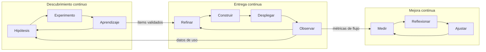

# Fases

| # | Fase | Pregunta que responde | Artefacto clave |
|---|---|---|---|
| 0 | [Diagnóstico y onboarding](00-diagnostico-onboarding.md) | ¿Dónde estamos y quiénes somos? | Assessment de madurez + Team Canvas |
| 1 | [Descubrimiento de producto](01-descubrimiento.md) | ¿Qué problema de negocio resolvemos y cómo sabremos que funcionó? | Lean Canvas + User Story Map + MVO |
| 2 | [Fundaciones técnicas](02-fundaciones-tecnicas.md) | ¿Podemos construir y desplegar de forma segura y repetible? | Diagramas C4 + pipeline CI/CD |
| 3 | [Sistema de trabajo](03-sistema-de-trabajo.md) | ¿Cómo fluye el trabajo y con qué reglas? | Tablero con políticas explícitas |
| 4 | [Entrega continua de valor](04-entrega-continua.md) | ¿Cómo llevamos valor a producción a menudo y con poco riesgo? | Release plan + checklist de producción |
| 5 | [Medición y aprendizaje](05-medicion.md) | ¿Está funcionando, para el negocio y para el equipo? | Dashboard de métricas |
| 6 | [Mejora, innovación y escalamiento](06-mejora-innovacion.md) | ¿Cómo seguimos mejorando y creciendo? | Backlog de mejora + portafolio de experimentos |
| T | [Gobierno con proveedores](transversal-gobierno-proveedores.md) | ¿Cómo gobernamos una célula externalizada por resultados? | Acuerdo de servicio por outcomes |
| T | [Traspaso a equipo interno](transversal-traspaso-proveedor.md) | ¿Cómo pasamos la célula del proveedor al equipo interno sin cortar el flujo? | Plan de traspaso |

## Ritmos en régimen

Una vez en marcha, la célula opera con tres ciclos que conviven:

