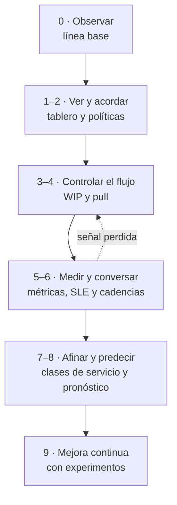

# Transversal · Implementar Scrumban paso a paso

Aplica cuando ya hiciste el diagnóstico de [Llegar a un equipo nuevo](transversal-llegar-equipo-nuevo.md) (o ya conoces al equipo) y acordaste una **puerta de entrada**. Es una escalera de diez peldaños, del 0 al 9, para sumar gestión de flujo a un equipo **desde donde está hoy**, un cambio pequeño a la vez.

El nombre dice Scrumban, pero la escalera es la misma para un equipo que se queda en Scrum y suma flujo, y para uno que trabaja con Kanban y necesita cadencias. Lo que cambia es qué cadencias se agregan en el peldaño 6 (ver [¿Es Scrumban lo que este equipo necesita?](#es-scrumban-lo-que-este-equipo-necesita)).

!!! abstract "Principio"
    Empieza por donde estás. Respeta lo que hoy funciona, cambia una cosa a la vez como experimento y sube de peldaño cuando se cumple su señal, **no cuando pasa el tiempo**. Si una señal se pierde, se baja un peldaño sin drama: es información, no un fracaso.

    Los pasos chicos, reversibles y propuestos por el equipo son también la mejor respuesta a la resistencia: ver [Resistencia al cambio](../biblioteca/facilitacion/resistencia-al-cambio.md) y, para leer dónde se traba cada persona, [Kotter y ADKAR](../biblioteca/facilitacion/kotter-adkar.md).

## Objetivo de negocio

Que el equipo entregue de forma **más predecible**, con menos trabajo en curso y menos esperas, y que pueda responder "¿cuándo?" con un rango y su probabilidad. Todo eso sin detener la entrega mientras cambia, y con un sistema que el equipo entiende, sostiene y sigue mejorando cuando quien lo acompañó ya no está.

## Entradas

- La salida de la [llegada](transversal-llegar-equipo-nuevo.md): línea base de métricas, puntaje de Flujo del assessment, % de demanda no planificada, puerta de entrada y primer experimento acordados con el equipo y el PO.
- El marco elegido con el árbol de la [Fase 3 §3.2](03-sistema-de-trabajo.md#32-elegir-el-marco-segun-la-demanda): Scrum con flujo, Scrumban o Kanban con cadencias.
- Acuerdo del equipo y del PO para cambiar por experimentos, y un patrocinador que sabe que no habrá un cambio de golpe.
- Permisos para cambiar el tablero en la herramienta (columnas, límites, fechas de inicio y fin).
- Alguien que prioriza (el PO o quien cumpla ese rol) disponible para la reposición.

## ¿Es Scrumban lo que este equipo necesita?

No siempre. El % de demanda no planificada decide con qué cadencias se recorre la escalera, según la [Fase 3 §3.2](03-sistema-de-trabajo.md#32-elegir-el-marco-segun-la-demanda). Los umbrales son **como referencia**, y conviene volver a medirlos cada trimestre.

| Caso | Cuándo | Qué cambia en el peldaño 6 |
|---|---|---|
| **Scrum + flujo** | Menos de 20 % no planificado y Scrum funciona | No se agregan eventos: los de Scrum usan datos de flujo |
| **Scrumban** | De 20 % a 50 % | Se conservan los eventos y se suma la reposición por umbral entre Planning y Planning |
| **Kanban con cadencias** | Más de 50 % | Sin Sprints: Kanban meeting, reposición, revisión de entrega y retro |

- **Scrum + flujo.** Si el Sprint Goal se cumple y lo urgente cabe en la capacidad reservada, no hay nada que "arreglar" con Scrumban. Los peldaños 1 a 5 y el 8 sirven igual, como propone la *Kanban Guide for Scrum Teams*: la Planning dimensiona con throughput, la Daily recorre el tablero, la Review habla de fechas con datos y la retro revisa políticas y límites. El peldaño 7 puede quedar en "estándar y capacidad reservada".
- **Scrumban.** El Sprint da el objetivo y el momento de inspeccionar; el flujo decide cuándo entra lo siguiente. La Planning deja de cargar el Sprint completo el primer día y, entre Plannings, se repone cuando la lista de "listos" cruza un umbral. Ver [Combinar cadencia y flujo](../biblioteca/scrumban/cadencia-y-flujo.md).
- **Kanban con cadencias.** La misma escalera, sin la capa de Sprints. En un equipo pequeño, lo esencial suele ser una Kanban meeting diaria, la reposición (semanal o por umbral), una revisión de entrega o del servicio con interesados y una retro cada 2 a 4 semanas. Ver [Las cadencias de Kanban](../biblioteca/kanban/cadencias-kanban.md).

Antes de recomendar un camino, lee [Cuándo sí y cuándo no Scrumban](../biblioteca/scrumban/cuando-scrumban.md). Si lo "no planificado" es en realidad trabajo que nadie filtra, el primer paso no es un marco: es ordenar la entrada de trabajo con el PO.

## Puertas de entrada

No todos los equipos empiezan en el peldaño 1. La puerta se elige al cerrar la llegada, con el puntaje de Flujo y las señales observadas (ver [Elegir la puerta de entrada](transversal-llegar-equipo-nuevo.md#elegir-la-puerta-de-entrada)):

| Si encuentras… | Entras por… | Lo primero que cuidas |
|---|---|---|
| Equipo sin marco, todo urgente | Peldaño 1, visualizar | No imponer ceremonias, solo hacer visible |
| "Scrum a medias" (sprints que no cierran, mucho trabajo no planificado) | Peldaños 2 y 3, políticas + WIP dentro del sprint | Mantener lo que funciona (Sprint Goal, retro) y agregar flujo |
| Kanban sin disciplina (tablero sin límites ni métricas) | Peldaños 3 y 4, WIP + pull | Sumar cadencias |
| Equipo maduro | Peldaños 5 y 8, métricas + pronóstico | Afinar, no cambiar |

Los puntajes de referencia para elegir están en [Elegir la puerta de entrada](transversal-llegar-equipo-nuevo.md#elegir-la-puerta-de-entrada).

- **Entrar alto no salta los peldaños de abajo.** En las primeras dos semanas, confirma que las señales de "listo, sigue" de los peldaños anteriores se cumplen. Si una no se cumple, baja a ese peldaño.
- **Si dudas entre dos puertas, entra por la más baja.** Confirmar rápido un peldaño cumplido cuesta poco; saltarse uno cuesta mucho.
- Las puertas de dos peldaños se trabajan juntas porque se sostienen entre sí: sin políticas, el límite de WIP no dice qué hacer al alcanzarlo; sin pull, el límite solo genera esperas.

## Resumen de señales

Para consultar rápido (por ejemplo, desde el teléfono): qué debe cumplirse antes de subir de peldaño.

| Peldaño | Señal de "listo, sigue" |
|---|---|
| 0 · Observar | Línea base y puerta de entrada acordadas con el equipo y el PO |
| 1 · Visualizar | Dos semanas con todo el trabajo en el tablero y bloqueos con motivo y fecha |
| 2 · Políticas | Tres personas responden igual cuándo un ítem cambia de columna |
| 3 · WIP | Límite respetado casi todos los días, ajustado al menos una vez con datos |
| 4 · Pull | Nadie asigna fuera de la regla; empezados y terminados se parecen |
| 5 · Métricas y SLE | SLE visible; ítems sobre P50 se conversan y los cercanos al SLE reciben acción |
| 6 · Cadencias | Cada cadencia con propósito, insumo y decisión registrada; reuniones bajo 10 % |
| 7 · Clases de servicio | Política escrita por clase, carril urgente bajo su límite, lead time por clase |
| 8 · Pronóstico | El PO pronostica solo una pregunta real y se compara con lo ocurrido |
| 9 · Mejora continua | El equipo propone experimentos y cierra con decisión basada en datos |

## Actividades

Cada peldaño indica su objetivo, cómo hacerlo, la señal que dice que está cumplido, una duración **como referencia**, el riesgo principal y las fichas de la [biblioteca](../biblioteca/index.md) que lo explican. Un peldaño es un experimento: se propone en la retro, se revisa con su señal y se escribe en las políticas si funciona.

!!! warning "Se avanza por criterio cumplido, no por calendario"
    Las duraciones sirven para planificar conversaciones con el patrocinador, no como plazo. Sumadas, dan entre cinco y diez meses desde el peldaño 1, también **como referencia**. Si el equipo sube mucho más rápido, revisa que las señales se cumplan de verdad y no solo en el papel.

### Peldaño 0 · Observar y tomar la línea base

- **Objetivo:** entender por qué el equipo trabaja como trabaja y tener datos para comparar cualquier cambio.
- **Cómo:** es el trabajo de la [llegada](transversal-llegar-equipo-nuevo.md): 1:1, observación, diario, 3 meses de datos y el assessment. Si ya conoces al equipo, basta con la línea base, el % no planificado y el puntaje de Flujo.
- **Señal de "listo, sigue":** línea base con lead time P85, throughput, WIP y % no planificado; puerta de entrada y primer experimento acordados con el equipo y el PO.
- **Duración típica:** las tres semanas de la llegada; una o dos si ya conoces al equipo.
- **Riesgo principal:** cambiar algo antes de entender para qué existe, o alargar la observación sin fecha.
- **Fichas:** [Cuándo sí y cuándo no Scrumban](../biblioteca/scrumban/cuando-scrumban.md) · [Cynefin](../biblioteca/facilitacion/cynefin.md) · [Diario de observación](../caja-de-herramientas/diario-observacion.md) · [Catálogo de métricas](../caja-de-herramientas/catalogo-metricas.md)

### Peldaño 1 · Visualizar el trabajo real

- **Objetivo:** que todo el trabajo del equipo, con sus tipos, esperas y bloqueos, se vea en un solo tablero.
- **Cómo:** sigue tres o cuatro ítems reales de punta a punta y dibuja sus estados. Separa "en curso" de "listo", distingue los tipos de trabajo (incluido el soporte y lo que llega por chat) y marca el punto de compromiso y el de entrega. Se dibuja lo que pasa, no lo que debería pasar.
- **Señal de "listo, sigue":** dos semanas seguidas en que lo que se dice en la Daily y en el canal está en el tablero, y los bloqueos se ven con motivo y fecha.
- **Duración típica:** una a dos semanas.
- **Riesgo principal:** diseñar el tablero ideal en vez del real, o terminar con dos tableros: uno para el jefe y otro para trabajar.
- **Fichas:** [Visualizar](../biblioteca/kanban/visualizar.md) · [STATIK](../biblioteca/kanban/statik.md) · [Value Stream Mapping](../caja-de-herramientas/value-stream-map.md)

### Peldaño 2 · Políticas explícitas

- **Objetivo:** que las reglas del sistema estén escritas, visibles y sean las mismas para todos.
- **Cómo:** empieza por las reglas que ya se cumplen de hecho. Una frase de entrada y otra de salida por columna, la DoR en el punto de compromiso, la DoD en la salida y lo mínimo transversal: cómo se elige el siguiente ítem, qué se hace con un bloqueo y qué es un urgente.
- **Señal de "listo, sigue":** tres personas responden igual cuándo un ítem pasa de columna, y las políticas están a un clic del tablero.
- **Duración típica:** dos a tres semanas; se escriben en una sesión, lo que toma tiempo es ver que se cumplen.
- **Riesgo principal:** un reglamento aspiracional que nadie cumple.
- **Fichas:** [Políticas explícitas](../biblioteca/kanban/politicas-explicitas.md) · [Plantilla de políticas](../caja-de-herramientas/politicas-tablero.md) · [DoR y DoD](../caja-de-herramientas/dor-dod.md) · [Artefactos y compromisos](../biblioteca/scrum/artefactos-y-compromisos.md)

### Peldaño 3 · Limitar el WIP

- **Objetivo:** que haya menos trabajo empezado a la vez, para terminar antes y ver los cuellos de botella.
- **Cómo:** cuenta el WIP actual, incluidos bloqueados y esperas. Acuerda primero un **límite total** igual o algo menor que el de hoy, y después límites por columna. Escribe qué se hace al llegar al límite. En Scrum, el límite rige dentro del Sprint y ayuda a cumplir el Sprint Goal.
- **Señal de "listo, sigue":** el límite se respeta la mayor parte de los días; cuando se supera, se conversa en la Daily ese mismo día, y ya se ajustó al menos una vez con datos.
- **Duración típica:** tres a seis semanas, incluido uno o dos ajustes del límite.
- **Riesgo principal:** un límite impuesto o bajado de golpe, que el equipo esquiva con trabajo "por fuera" del tablero.
- **Fichas:** [WIP y sistema pull](../biblioteca/kanban/wip-y-pull.md) · [Ley de Little](../biblioteca/flujo/ley-de-little.md)

### Peldaño 4 · Sistema pull y empezar por la derecha

- **Objetivo:** que el trabajo se tome cuando hay capacidad, y que terminar valga más que empezar.
- **Cómo:** escribe la regla de *pull*: quién toma el siguiente ítem y de dónde. La Daily recorre el tablero de derecha a izquierda, empezando por los ítems más viejos y los bloqueados. Ante el límite, el equipo ayuda a terminar, revisa o hace *pairing*.
- **Señal de "listo, sigue":** nadie asigna trabajo fuera de la regla, y en las últimas cuatro semanas se empezaron más o menos tantos ítems como se terminaron.
- **Duración típica:** dos a cuatro semanas.
- **Riesgo principal:** que una persona sin ítem propio se lea como ociosa y alguien le asigne trabajo nuevo. Prepara antes al PO y a los jefes.
- **Fichas:** [WIP y sistema pull](../biblioteca/kanban/wip-y-pull.md) · [Work item age](../biblioteca/flujo/work-item-age.md) · [Daily Scrum](../biblioteca/scrum/daily-scrum.md)

### Peldaño 5 · Métricas de flujo y SLE

- **Objetivo:** responder "¿cuánto tarda un ítem?" con datos, y actuar sobre los ítems mientras todavía están en curso.
- **Cómo:** acuerda dónde empieza y dónde termina la medición; el playbook usa lead time, del compromiso a la entrega. Muestra la edad de cada ítem en el tablero. Calcula el SLE con ítems terminados **después** de los límites de WIP, porque los anteriores son de otro sistema. Mientras juntas datos, publica un SLE provisional y dilo.
- **Señal de "listo, sigue":** el SLE está escrito y visible, y los ítems que pasan el P50 se conversan en la Daily y los que se acercan al SLE reciben acción antes de superarlo.
- **Duración típica:** cuatro a ocho semanas, lo que tarda juntar datos del sistema nuevo. Mientras tanto, puedes empezar el peldaño 6 con un SLE provisional.
- **Riesgo principal:** usar las métricas para evaluar personas o comparar equipos, o negociar el SLE como una promesa.
- **Fichas:** [Métricas y vocabularios](../biblioteca/flujo/metricas-y-vocabularios.md) · [Scatterplot, percentiles y SLE](../biblioteca/flujo/scatterplot-sle.md) · [Work item age](../biblioteca/flujo/work-item-age.md) · [Cómo leer un CFD](../biblioteca/flujo/cfd.md)

### Peldaño 6 · Cadencias

- **Objetivo:** que haya momentos fijos para reponer trabajo, revisar la entrega con interesados y mejorar el sistema con datos.
- **Cómo:** haz el mapa de las reuniones que ya existen y de la decisión que se toma en cada una. Agrega solo lo que falta (casi siempre la reposición) y dale a cada cadencia un insumo de datos. Qué se agrega depende del caso: ver [¿Es Scrumban lo que este equipo necesita?](#es-scrumban-lo-que-este-equipo-necesita).
- **Señal de "listo, sigue":** cada cadencia tiene propósito, insumo y una decisión registrada en su último ciclo, la lista de "listos" no se vacía ni se desborda, y el total de reuniones no supera el 10 % del tiempo.
- **Duración típica:** uno o dos ciclos de cada cadencia; como referencia, cuatro a seis semanas.
- **Riesgo principal:** sumar reuniones sin quitar ninguna, o quitar la retro o la review "porque ahora fluimos".
- **Fichas:** [Las cadencias de Kanban](../biblioteca/kanban/cadencias-kanban.md) · [Combinar cadencia y flujo](../biblioteca/scrumban/cadencia-y-flujo.md) · [Calendario de cadencias](../caja-de-herramientas/calendario-cadencias.md) · [Retrospectiva basada en datos](../caja-de-herramientas/retro-datos.md)

### Peldaño 7 · Clases de servicio

- **Objetivo:** tratar distinto lo que tiene un costo de demora distinto, sin que todo se vuelva urgente.
- **Cómo:** agrupa los ítems de los últimos meses por perfil de urgencia y define solo las clases que aparecen de verdad; muchas veces alcanza con estándar y expedito. Cada clase lleva su política: quién la asigna, su límite de WIP y cómo entra.
- **Señal de "listo, sigue":** cada clase tiene su política escrita, el carril urgente se mantiene bajo su límite y el lead time se mide por clase.
- **Duración típica:** tres a seis semanas.
- **Riesgo principal:** un carril urgente sin límite, por donde termina entrando la mitad del trabajo.
- **Fichas:** [Clases de servicio](../biblioteca/kanban/clases-de-servicio.md) · [Plantilla de políticas](../caja-de-herramientas/politicas-tablero.md#clases-de-servicio) · [Cost of Delay y WSJF](../caja-de-herramientas/cost-of-delay-wsjf.md)

### Peldaño 8 · Pronóstico probabilístico

- **Objetivo:** responder "¿cuándo?" y "¿cuánto?" con un rango y su probabilidad, en vez de una fecha prometida.
- **Cómo:** para un ítem, usa el percentil acordado o el SLE. Para un conjunto, simula con el throughput de 8 a 12 semanas recientes del sistema actual. Comunica el rango, no un número suelto, y vuelve a pronosticar cada semana.
- **Señal de "listo, sigue":** el PO responde con un pronóstico, sin ayuda del coach, al menos una pregunta real de negocio, y ese pronóstico se comparó después con lo que pasó.
- **Duración típica:** cuatro a ocho semanas, porque hay que ver cómo resultó un pronóstico.
- **Riesgo principal:** que el percentil 85 se convierta en fecha comprometida, o pronosticar con datos de un sistema que ya cambió.
- **Fichas:** [Pronóstico probabilístico](../biblioteca/flujo/pronostico-probabilistico.md) · [Pronóstico Monte Carlo](../caja-de-herramientas/pronostico-monte-carlo.md)

### Peldaño 9 · Mejora continua con experimentos

- **Objetivo:** que el equipo siga mejorando su sistema por su cuenta, con datos.
- **Cómo:** cada retro termina en, como máximo, un experimento con hipótesis, señal de éxito y fecha de revisión. Las políticas, los límites y las cadencias se cambian ahí, y el cambio queda registrado.
- **Señal de "listo, sigue":** este peldaño no termina. Su señal de salud es que los experimentos los propone el equipo, se cierran con una decisión basada en datos y las políticas cambian sin que el coach lo pida.
- **Duración típica:** permanente; cada experimento, como referencia, de dos a cuatro semanas.
- **Riesgo principal:** experimentos que propone el coach y el equipo solo tolera, o cambiar varias cosas a la vez y no saber cuál funcionó.
- **Fichas:** [Retrospectiva basada en datos](../caja-de-herramientas/retro-datos.md#formato-del-experimento-de-mejora) · [Principios y prácticas del Kanban Method](../biblioteca/kanban/kanban-method.md) · [Liberating Structures](../biblioteca/facilitacion/liberating-structures.md) · [Fase 6](06-mejora-innovacion.md)

## Si vienes de "Scrum a medias"

Es la puerta más frecuente: hay Sprints, pero no cierran, y el trabajo entra a mitad de camino. No se trata de abandonar Scrum, sino de quedarse con lo que funciona y sumar disciplina de flujo. Ninguna pieza se quita antes de tener límites de WIP y métricas (peldaños 3 y 5).

| Pieza | Se conserva | Se transforma |
|---|---|---|
| Sprint Goal | El foco común del Sprint | Deja de ser una lista de ítems; el límite de WIP ayuda a cumplirlo |
| Sprint Planning | El por qué y el qué del Sprint | Dimensiona con throughput y no carga toda la capacidad el primer día |
| Daily Scrum | 15 minutos de los Developers | Recorre el tablero de derecha a izquierda, con ítems viejos y WIP excedido |
| Refinamiento | Preparar ítems con el PO | Se dispara cuando la lista de "listos" cruza el umbral |
| Sprint Review | La conversación con interesados | Suma fechas probables con datos |
| Retrospectiva | El momento de mejorar | Usa datos y revisa políticas y límites |
| DoD y accountabilities | Sin cambios | La DoD pasa a ser la política de salida de la última columna |
| Estimación en puntos | Mientras el equipo la use para conversar | Para pronosticar, se prueba el throughput; no se usan dos medidas a la vez |

La duración del Sprint no se toca hasta el peldaño 6. Si después la reposición por umbral funciona, el equipo puede revisar en la retro si el Sprint todavía le sirve, como experimento y con datos. Ver [Qué es Scrumban](../biblioteca/scrumban/que-es-scrumban.md): transición o destino es una decisión del equipo, no de quien lo acompaña.

## Artefactos

| Artefacto | Dónde |
|---|---|
| Tablero con tipos de trabajo, punto de compromiso y de entrega | Herramienta del equipo |
| Políticas por columna, DoR y DoD | [Plantilla de políticas](../caja-de-herramientas/politicas-tablero.md) y [DoR y DoD](../caja-de-herramientas/dor-dod.md) |
| Límites de WIP y regla de pull | En el tablero, con las políticas |
| SLE publicado | En el tablero |
| Calendario de cadencias | [Plantilla](../caja-de-herramientas/calendario-cadencias.md) |
| Políticas por clase de servicio | [Plantilla de políticas](../caja-de-herramientas/politicas-tablero.md#clases-de-servicio) |
| Pronósticos compartidos con negocio | [Pronóstico Monte Carlo](../caja-de-herramientas/pronostico-monte-carlo.md) |
| Registro de la escalera: peldaño, señal cumplida y fecha | Espacio del equipo |
| Registro de experimentos | [Retrospectiva basada en datos](../caja-de-herramientas/retro-datos.md#formato-del-experimento-de-mejora) |

## Métricas

Se comparan contra la línea base del peldaño 0:

| Métrica | Qué indica |
|---|---|
| Trabajo hecho que no pasó por el tablero | Si el peldaño 1 se sostiene |
| Días con el WIP sobre el límite | Si el límite se respeta o es decorativo |
| Ítems empezados frente a terminados | Si el sistema está estable |
| Lead time P85 y distancia entre P50 y P95 | Predictibilidad: debe bajar y estrecharse |
| % de ítems terminados dentro del SLE | Si el SLE describe al sistema |
| % de ítems en curso que superaron el SLE (debe bajar) | Si se actúa a tiempo |
| % no planificado y uso del carril urgente | Si cambió la demanda o se abusa de lo urgente |
| Pronósticos que acertaron dentro de su rango | Si negocio puede confiar en ellos |
| Experimentos cerrados con decisión | Si la mejora es continua |

El peldaño actual no es una métrica de desempeño: sirve para ver dónde se atasca el cambio, no para apurarlo ni para comparar equipos.

## Roles

| Actividad | Responsable | Aprueba | Consultado (C) e informado (I) |
|---|---|---|---|
| Elegir la puerta de entrada | SM / Coach | Equipo y PO | Patrocinador (I) |
| Diseñar tablero y políticas | Equipo (SM facilita) | Equipo | PO (C) |
| Fijar y ajustar límites de WIP | Equipo | Equipo | PO (C) · Interesados (I) |
| Umbral de reposición y prioridad | PO | PO | Equipo (C) |
| Calcular y publicar el SLE | Equipo (SM facilita) | Equipo y PO | Interesados (I) |
| Definir clases de servicio | PO y equipo | PO | Interesados (C) |
| Pronósticos para negocio | PO | PO | Equipo (C) · Patrocinador (I) |
| Declarar un peldaño cumplido | Equipo | Equipo | PO (C) · Patrocinador (I) |

Quien acompaña propone y facilita; **el equipo decide** cuándo un peldaño está cumplido.

## Criterios de salida

La escalera no tiene fin, pero el acompañamiento sí. Se puede dar por cerrado cuando:

- [ ] Los peldaños 1 a 8 tienen su señal cumplida y registrada, o una razón escrita para no aplicarlos (por ejemplo, solo la clase estándar).
- [ ] El tablero, las políticas, los límites de WIP y el SLE están visibles y vigentes.
- [ ] Las cadencias están en el calendario, con insumo de datos, y no superan el 10 % del tiempo.
- [ ] El lead time P85 y su dispersión están igual o mejor que en la línea base.
- [ ] El PO respondió al menos un "¿cuándo?" de negocio con un pronóstico, y se comparó con lo que pasó.
- [ ] El equipo cerró al menos dos experimentos propuestos por sus integrantes, con decisión basada en datos.
- [ ] El % no planificado se volvió a medir, y el marco (Scrum con flujo, Scrumban o Kanban con cadencias) se confirmó o se cambió.
- [ ] El sistema se sostiene un mes sin intervención de quien acompañó.

## Antipatrones

- **Subir por calendario:** "este mes toca WIP", aunque el tablero todavía no muestre el trabajo real.
- **Puerta demasiado alta:** SLE y pronósticos sobre un tablero que no refleja lo que pasa.
- **La escalera en un taller:** instalar todos los peldaños de una vez, con un tablero nuevo y una herramienta nueva.
- **Límites impuestos:** el número lo pone el coach o el jefe, y el equipo lo esquiva.
- **Scrumban como excusa:** quitar la retro, la review o el Sprint Goal antes de tener límites y métricas.
- **La escalera como auditoría:** usar los peldaños para calificar equipos o compararlos entre sí.
- **SLE negociado:** fijar el SLE por lo que el cliente quiere oír, no por lo que dicen los datos.
- **No bajar nunca:** seguir subiendo aunque un peldaño anterior perdió su señal.
- **La escalera del coach:** los cambios los propone siempre quien acompaña, y el sistema se cae cuando se va.
