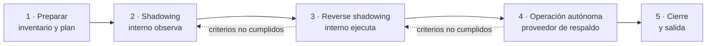

# Transversal · Traspaso de proveedor a equipo interno

Aplica cuando una célula **externalizada o mixta** pasa a manos de un **equipo interno** (*insourcing*), total o parcialmente. Es la ejecución del plan de salida definido en [Gobierno con proveedores](transversal-gobierno-proveedores.md) y una variante exigente de la ruta **Tomar**: el equipo que recibe no existe o es nuevo, y el equipo que conoce el sistema se va.

!!! abstract "Principio del traspaso"
    No se traspasa un sistema: se traspasa la **capacidad de cambiarlo con seguridad**. El traspaso termina cuando el equipo interno lleva cambios a producción y resuelve incidentes sin ayuda, no cuando vence el contrato.

## Objetivo de negocio

Transferir la operación y la evolución del producto al equipo interno **sin interrumpir el flujo de valor** ni degradar la calidad en producción, y dejar al cliente con control total sobre el código, la infraestructura, los datos y el conocimiento.

## Entradas

- Decisión de traspaso aprobada por el patrocinador, con fecha objetivo y alcance (total, parcial o por dominio).
- Contrato vigente con su plan de salida: periodo de traslape, entregables, propiedad intelectual y continuidad del servicio.
- Equipo interno identificado, aunque esté incompleto, y presupuesto para contratar lo que falte.
- Assessment de madurez reciente de la célula (si no existe, se aplica en la etapa 1).
- Línea base de métricas de flujo, DORA y calidad (ver [Fase 5](05-medicion.md)).

## Etapas del traspaso

| Etapa | Quién ejecuta | Quién respalda | Duración de referencia |
|---|---|---|---|
| 1 · Preparar | Proveedor y cliente | — | 2–3 semanas |
| 2 · Shadowing | Proveedor | Equipo interno observa y pregunta | 2–4 semanas |
| 3 · Reverse shadowing | Equipo interno | Proveedor revisa y corrige | 3–6 semanas |
| 4 · Operación autónoma | Equipo interno | Proveedor disponible a demanda | 4–8 semanas |
| 5 · Cierre | Cliente | — | 1–2 semanas |

!!! warning "Las etapas avanzan por criterios, no por calendario"
    Si el equipo interno no cumple los criterios de una etapa, se extiende el traslape. Cortar el traslape para cumplir una fecha traslada el riesgo a producción.

## Actividades

### T.1 Preparar el traspaso

1. **Inventario de activos**: repositorios, pipelines, ambientes, cuentas cloud, dominios, certificados, secretos, licencias, herramientas SaaS, bases de datos y backups. Para cada activo: dónde vive, quién es dueño y si está a nombre del cliente.
2. **Transferir la propiedad antes que el conocimiento**: todo activo que esté a nombre del proveedor pasa al cliente en esta etapa, y se **rotan las credenciales** compartidas.
3. **Mapa de conocimiento**: listar dominios funcionales, componentes técnicos y procesos operativos (despliegue, monitoreo, guardias, cierres de mes), con quién los domina hoy y quién los recibirá. Ver [plan de traspaso](../caja-de-herramientas/plan-traspaso.md).
4. **Brechas de documentación**: verificar que existan diagramas C4, ADRs, runbooks, DoR/DoD y políticas del tablero. Lo que falte se produce **durante** el shadowing, escrito por el equipo interno y revisado por el proveedor.
5. **Plan de personas**: perfiles necesarios, contrataciones, y si alguna persona del proveedor se incorporará al cliente (revisar cláusulas contractuales).
6. **Congelar el riesgo, no el producto**: acordar con el PO qué cambios de alto riesgo (migraciones, cambios de arquitectura) se adelantan o posponen para no coincidir con el cambio de manos.

### T.2 Shadowing: el equipo interno observa

- Equipo interno y proveedor trabajan en el **mismo tablero y las mismas ceremonias**. No hay un tablero de traspaso separado.
- Cada persona interna tiene una **contraparte** en el proveedor por área de conocimiento.
- El equipo interno participa en refinamientos, code reviews, despliegues e incidentes como observador activo.
- Sesiones de transferencia **sobre trabajo real**, no presentaciones: recorrer el código de una historia en curso, un despliegue o un postmortem.
- El equipo interno levanta su entorno local de cero y despliega un cambio trivial a staging (*walking skeleton* del traspaso).

### T.3 Reverse shadowing: el equipo interno ejecuta

- El equipo interno toma historias reales y las lleva a producción; el proveedor **revisa** pull requests y despliegues.
- El equipo interno entra a la **guardia** con el proveedor como segundo nivel.
- Se practica al menos un **rollback** y un **restore de backup** conducidos por el equipo interno.
- Cada sesión de transferencia termina con un artefacto actualizado (runbook, ADR, diagrama) en el repositorio del cliente.

### T.4 Operación autónoma con respaldo

- El equipo interno opera solo. El proveedor queda **disponible a demanda** con un tiempo de respuesta acordado y un tope de horas.
- Cada consulta al proveedor se registra: qué se preguntó y qué documentación faltaba. Es el mejor indicador de lo que el traspaso no cubrió.
- Se revisan las métricas contra la línea base en la revisión de servicio.

### T.5 Cierre y salida

1. Verificar que el **inventario de activos** está completo, a nombre del cliente y con credenciales rotadas.
2. Retirar los accesos del proveedor a todos los sistemas.
3. Cerrar formalmente el contrato: entregables recibidos, propiedad intelectual y garantías.
4. **Retrospectiva de traspaso** con ambos equipos: qué funcionó, qué aprendimos para el próximo.
5. Volver a aplicar el [assessment de madurez](../caja-de-herramientas/assessment-madurez.md) y retomar el ciclo desde la [Fase 0](00-diagnostico-onboarding.md) con el equipo interno.

### T.6 Cuidar a las personas

- El equipo saliente pierde el incentivo a transferir: acordar con el proveedor **bonos o hitos de pago ligados a los criterios de traspaso**, no a la fecha.
- Explicitar al equipo interno qué decide desde el primer día y cómo cambia con el tiempo en el [Delegation Board](../caja-de-herramientas/delegation-board.md).
- Hacer un nuevo [Team Canvas](../caja-de-herramientas/team-canvas.md) cuando el equipo interno queda solo: es otro equipo.

## Artefactos

| Artefacto | Plantilla |
|---|---|
| Inventario de activos | [Plan de traspaso](../caja-de-herramientas/plan-traspaso.md) |
| Mapa de conocimiento | [Plan de traspaso](../caja-de-herramientas/plan-traspaso.md) |
| Runbooks operativos | Repo del producto, `docs/runbooks/` |
| Diagramas C4 y ADRs actualizados | Repo del producto (ver [Fase 2](02-fundaciones-tecnicas.md)) |
| Registro de consultas al proveedor | [Plan de traspaso](../caja-de-herramientas/plan-traspaso.md) |
| Acta de cierre | — |

## Métricas

Durante el traspaso, el éxito es que **las métricas no se degraden** respecto a la línea base:

| Métrica | Qué indica |
|---|---|
| Lead time y throughput | El flujo de valor sigue funcionando durante el cambio de manos |
| Change failure rate y tiempo de recuperación | La calidad en producción se mantiene |
| % de despliegues hechos por el equipo interno | Avance real del traspaso |
| % del mapa de conocimiento con al menos 2 personas internas | Reducción del *bus factor* |
| Consultas al proveedor por semana | Debe tender a cero en la etapa 4 |
| Tiempo para levantar el entorno local por una persona interna | Calidad de la documentación |

## Roles

| Actividad | Patrocinador | PO | Tech Lead interno | Equipo interno | Proveedor | SM / Coach |
|---|---|---|---|---|---|---|
| Decisión y plan de traspaso | A | R | C | I | C | C |
| Inventario y transferencia de activos | I | A | R | C | R | I |
| Shadowing y reverse shadowing | I | C | A | R | R | F |
| Avance de etapa | C | A | R | C | C | F |
| Cierre y salida | A | R | R | C | C | I |

*F = facilita.*

## Criterios de salida

- [ ] Todos los activos del inventario están a nombre del cliente y con credenciales rotadas.
- [ ] El proveedor no tiene accesos activos.
- [ ] El equipo interno desplegó a producción, ejecutó un rollback y resolvió un incidente sin ayuda.
- [ ] Cada área del mapa de conocimiento tiene al menos 2 personas internas que la dominan.
- [ ] Runbooks, C4, ADRs y DoR/DoD vigentes en el repositorio del cliente.
- [ ] Métricas de flujo y calidad iguales o mejores que la línea base durante 4 semanas.
- [ ] Retrospectiva de traspaso hecha y assessment de madurez reaplicado.

## Antipatrones

- **Traspaso por documentos**: el proveedor entrega un "manual" en la última semana y se va.
- **Traslape cortado por presupuesto**: se ahorra un mes de proveedor y se paga en incidentes.
- **Activos a nombre del proveedor**: cuentas cloud, dominios o licencias que el cliente descubre que no controla.
- **Big bang**: todo el conocimiento cambia de manos el mismo día. Traspasar por dominio o componente reduce el riesgo.
- **Tablero paralelo de traspaso**: la transferencia compite con el producto en lugar de hacerse sobre el trabajo real.
- **Héroe interno**: una sola persona recibe todo el conocimiento y reemplaza la dependencia del proveedor por otra.
