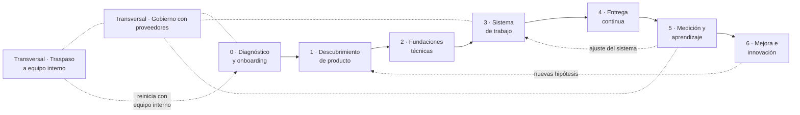

# Agile Cell Playbook

**Una metodología para crear o tomar una célula ágil y convertirla en un sistema que entrega valor de negocio de forma predecible y sostenible.**

!!! abstract "Principio rector"
    No optimizamos la actividad del equipo: optimizamos el **flujo de valor** desde que nace una necesidad de negocio hasta que un usuario la usa en producción y medimos si cambió algo.

## ¿Para quién es?

- **Scrum Masters, Agile Coaches y Delivery Leads** que forman o reciben una célula.
- **Product Owners / Product Managers** que necesitan un marco para descubrir y priorizar.
- **Líderes técnicos** que deben asegurar fundaciones de ingeniería sanas.
- **Gerencias y áreas de compras** que contratan células externalizadas y quieren gobernarlas por resultados.

## Los dos escenarios

=== "Crear una célula nueva"

    Partes desde cero: no hay equipo, quizá no hay producto. Recorres las fases 0 → 6 en orden, con foco fuerte en Descubrimiento (1) y Fundaciones técnicas (2) antes de acelerar la entrega.

=== "Tomar una célula existente"

    Hay un equipo trabajando, con historia, deuda y hábitos. La Fase 0 es un **diagnóstico** y define qué fases reforzar primero. No se rehace todo: se estabiliza el flujo y luego se mejora.

    Si la célula pasa de un proveedor a un equipo interno, sigue además el capítulo de [Traspaso a equipo interno](fases/transversal-traspaso-proveedor.md).

## Mapa de la metodología

Las fases son **secuenciales al arrancar** y **cíclicas en régimen**: una vez la célula está en marcha, las fases 1 a 6 conviven en paralelo como ciclos de distinto ritmo (descubrimiento continuo, entrega continua, mejora continua).

## Marcos que integra

| Marco | Para qué lo usamos |
|---|---|
| **Lean** | Eliminar desperdicio, ver el flujo de valor completo, limitar el WIP |
| **Kanban** | Gestionar el flujo, hacer visibles las políticas, medir lead time y throughput |
| **Scrum** | Cadencia, compromiso con objetivos de sprint, inspección y adaptación |
| **Lean Startup** | Validar hipótesis de negocio con el menor esfuerzo (Construir–Medir–Aprender) |
| **MVO / MVP** | Definir el resultado mínimo que valida una apuesta y el producto mínimo para lograrlo |
| **User Story Mapping** | Ordenar el backlog según el recorrido del usuario y cortar releases con sentido |
| **Management 3.0** | Autoorganización, delegación explícita, motivación y salud del equipo |
| **C4 + ADR** | Comunicar y decidir arquitectura de forma liviana y trazable |
| **CI/CD + Docker** | Entregar en lotes pequeños, frecuentes y con bajo riesgo |
| **DORA** | Medir el desempeño de entrega de software |

## Cómo está organizada cada fase

Todas las fases siguen la misma plantilla para que sean fáciles de recorrer y auditar:

1. **Objetivo de negocio** de la fase.
2. **Entradas** necesarias.
3. **Actividades** paso a paso.
4. **Artefactos** que se producen.
5. **Métricas** que indican si la fase funciona.
6. **Roles** involucrados (RACI liviano).
7. **Criterios de salida**: checklist para pasar a la siguiente.
8. **Antipatrones** frecuentes.

Empieza por [Cómo usar la guía](como-usar.md).
